# 第一部分 概述

## 1. 建设背景与目标

蓝穹云眼·环境监管工作台是一套面向生态环境主管部门的环境监测与执法辅助平台。平台以城市空气质量自动监测数据为基础，将"观测—评价—线索—核查—整改—复查—归档"各环节纳入统一系统管理，解决监测数据分散、异常发现滞后、核查过程不可追溯、数据来源难以说明等问题。

本期建设目标：

- 在一个政府部门内开展试运行，覆盖日常监测分析、标准评价、线索管理、核查整改闭环、报告导出与系统管理等核心功能；
- 建立完整的数据溯源体系：每一条观测数据可追溯至原始来源文件及其 SHA-256 指纹，每一次评价可追溯至评价时生效的标准快照；
- 建立数据源许可门禁机制：试运行期间使用 Quotsoft 公开数据须留存可审计的授权确认记录，正式运行须接入官方监测接口；
- 为政务云正式部署预留架构与接口位置，业务链路不因数据源切换而改动。

## 2. 系统定位与边界

**系统定位**：辅助研判工具。平台提供超标识别、线索归集、核查流转、整改跟踪与留档能力，为监管决策和执法准备提供数据支撑。

**边界声明**：

- 公开观测数据辅助研判；企业关联与适用依据由执法人员确认，系统不自动作出处罚结论；
- 核查、整改、复核各环节的法律适用性判断由责任人作出，系统负责流程约束与留痕；
- 预测结果为模型辅助产出，页面明确标注为预测值，不作为执法依据；评价输出为辅助站点评价，不替代正式监测审核；
- 行政处罚办理、电子签章、正式送达和自动归责不属于首期平台流程；
- 试运行期间数据源为 Quotsoft 公开镜像，正式运行将直接接入官方监测接口，二者不可混用。

## 3. 术语与数据口径

| 术语 | 说明 |
| --- | --- |
| 观测数据 | 站点每小时上报的污染物浓度原始值，入库存 UTC，页面按北京时间展示 |
| 评价记录 | 依据现行有效标准对站点某日某污染物的浓度评价结果，含超标倍数与完整性 |
| AQI | 空气质量指数，按国家标准六级：优/良/轻度/中度/重度/严重 |
| 线索 | 由超标评价或人工登记产生的待研判事项，可分派为核查任务 |
| 核查任务 | 执法闭环载体，状态机驱动：待核查→现场核查→整改跟踪→复查→主管审核→已归档 |
| 来源文件 | 一次采集下载的原始文件，含 SHA-256 指纹，修订不覆盖历史版本 |
| 实测/派生 | 实测为原始观测；插补与预测写入派生值存储，与原始证据分离 |
| 许可门禁 | 数据源使用的授权确认机制，须登记有效授权证据后方可启用 |
| 观测日期范围 | 顶栏全局筛选，作用于监测、评价、预测、报告等页面 |

## 4. 文档读者与使用说明

本说明书分为主册与技术附录册两册：

- **主册**（本册）：面向业务负责人、监管人员与验收评审，描述建设目标、总体架构、部署形态、各功能页面的操作说明、数据溯源与安全机制、运维验收流程；
- **技术附录册**：面向信息化评审与后续运维开发，给出接口清单、数据字典、接口级权限明细与枚举值表，由脚本从运行系统生成，保证与代码一致。

文中约定：【】括号为交付前需人工填写的占位信息；界面截图均来自试运行环境真实数据；标注"原型示意"的图为设计稿，正式实现以系统为准。

# 第二部分 总体架构

## 5. 架构总览

平台采用模块化单体架构。FastAPI 应用承载同步业务事务与查询接口；Celery 工作进程处理采集、导入、评价、训练、预测、插补与导出等耗时任务；独立调度器负责计划任务；PostgreSQL 为唯一业务数据库，Redis 承担消息代理与协调；Nginx 同源提供前端静态资源与 `/api/v2` 反向代理，浏览器无需处理跨域。


## 6. 模块边界

后端按业务域组织于 `app/v2/domains`，模块间通过端口/服务接口协作，禁止跨域直写数据表。

| 模块 | 责任 |
| --- | --- |
| auth | Argon2 口令散列、会话 Cookie、CSRF 校验、会话吊销、失败计数锁定与拒绝审计 |
| monitoring / collection | 城市站点目录、原始文件修订、时序与质量查询、数据源适配 |
| evaluation / seed | 标准有效期管理、完整性判定、站点日评价与 AQI 计算 |
| jobs / scheduler | 任务事务、事务发件箱、队列派发、心跳、恢复与计划调度 |
| datasets / forecasting / imputation / ml | 数据快照、隔离训练、原尺度评估、模型制品与推理 |
| enforcement | 企业档案、线索认领、任务归属、核查整改状态机、附件 |
| admin / notifications | 用户、标准法规、数据源、模型维护、站内及外部通知 |
| storage / exports / backup | 私有内容寻址文件存储、受控导出、备份核验 |

## 7. 核心数据流

主链路：调度器按计划下发采集任务 → 工作进程经适配器获取来源文件 → 文件指纹登记为不可变 SourceFile → 观测数据入库并标记修订关系 → 评价引擎按现行标准产出评价记录与 AQI → 超标记录进入线索研判 → 分派生成核查任务 → 执法人员执行现场核查/整改/复核 → 主管审核归档。

旁路：训练与预测任务读取观测快照，产出写入派生值存储，不触碰原始证据；插补同样走独立通道，查询接口以独立字段返回。


## 8. 核心实体关系

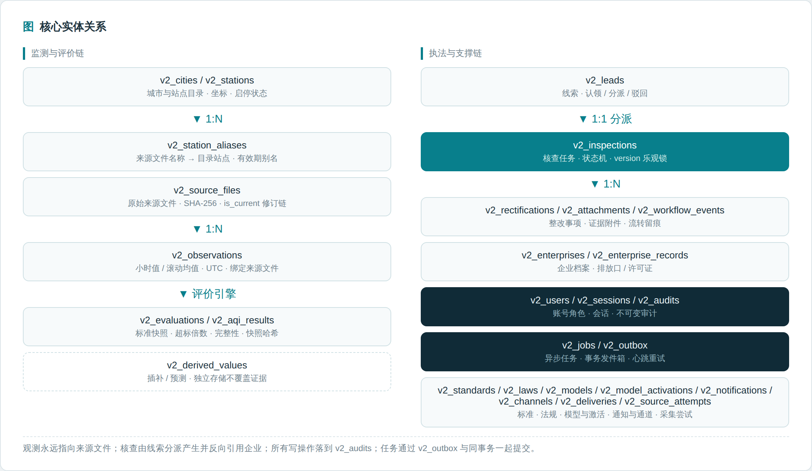

要点：观测记录永远指向来源文件；核查任务由线索分派产生并可关联企业；所有关键写操作落入审计表；异步任务经发件箱与业务写入同一事务提交。

## 9. 前端架构

前端为 React 19 单页应用，使用 Ant Design 5 组件库与官方 React 19 兼容补丁，ECharts 承担图表渲染，构建产物由 Nginx 静态托管。

**路由结构**（全部须经登录会话访问）：

| 路径 | 页面 | 可见角色 |
| --- | --- | --- |
| `/login`、`/change-password` | 登录、修改密码 | 公开/已登录 |
| `/` | 工作台（按角色差异化） | 全部 |
| `/monitoring`、`/stations/:id` | 监测分析、站点详情 | 全部 |
| `/evaluations`、`/forecasts` | 标准评价、趋势预测 | 全部 |
| `/leads`、`/inspections`、`/inspections/:id`、`/enterprises`、`/enterprises/:id` | 线索、核查、企业 | 管理员/监管主管/执法人员 |
| `/models`、`/reports` | 模型中心、报告与下载 | 全部（写操作按角色限制） |
| `/admin` | 系统管理 | 管理员 |

**设计系统**：共享令牌 `shared/tokens.ts` 定义浅色工作台与深色大屏两套色板，AQI 六级色与业务状态色分离；`shared/ui.tsx` 沉淀指标卡、AQI 徽标、站点地图、日历热力、新鲜度条、期限进度条等组件。

**全局要素**：

- 顶栏含工作空间名、城市选择器、更新标识、通知铃铛（未读计数）与用户菜单（角色/修改密码/退出）；
- 上下文栏含面包屑与全局观测日期范围，筛选写入 URL，可直接分享链接；
- 全站水印（姓名 + 登录名 + 当日日期）覆盖页面内容区，震慑拍照外发；
- 加载中、空结果、403 无权限、请求失败、数据延迟分别呈现；无数据显示"暂无数据"，不虚构生产值；
- 核查事实未保存时，路由切换与页面关闭均弹出确认提示。

## 10. 后端分层与接口契约

每个业务域按 `router → service → repository/port` 分层：路由层只做鉴权与出入参，服务层承载用例与事务边界，仓储层访问持久化，外部资源经端口接口注入，便于替换与测试。

**API 契约**：

- 分页参数 `page_number`/`page_size`，返回 `items, total, page, page_size, request_id`，分页采用稳定主键次序；
- 异步任务 `POST /jobs`、`POST /imports` 返回 202 与 `job_id`，`GET /jobs/{id}` 返回状态、进度、失败原因与下载可用性；
- 监测时间范围按北京自然日传入 `start,end`，观测瞬时值存 UTC；
- 错误返回稳定结构 `code, message, details, request_id`，不回传 SQL、服务器路径或秘密；
- 接口文档运行时位于 `/api/v2/docs`（OpenAPI），前端接口类型由契约生成并校验一致性。

## 11. 技术选型

| 层 | 选型 | 说明 |
| --- | --- | --- |
| 前端 | React 19 + Ant Design 5 + Vite + ECharts | React 19 官方兼容补丁；自主设计令牌体系 |
| API | FastAPI + SQLAlchemy 2.x + Pydantic v2 | OpenAPI 自动生成接口文档与前端类型 |
| 任务 | Celery + Redis | `io` 队列、延迟确认、进程终止拒绝重投 |
| 模型 | LightGBM / SAITS / BRITS（PyPOTS） | 独立模型镜像，与 API 进程隔离重依赖 |
| 数据库 | PostgreSQL 16 | 事务发件箱、行级目标锁、审计独立提交 |
| 部署 | Docker Compose + Nginx | 七服务拓扑，可平移政务云托管服务 |
| 质量 | pytest + mypy 严格模式 + tsc + vitest + Playwright | 前后端自动化验证，详见第 41 章 |

# 第三部分 部署架构

## 12. 服务拓扑


| 服务 | 职责 |
| --- | --- |
| web | Nginx：前端静态资源 + `/api/v2` 反代 + 安全响应头（CSP/nosniff/frame 等） |
| api | FastAPI 业务接口与事务，就绪探针 `/health/ready` |
| worker | Celery IO 型任务：采集、导入、评价、导出 |
| model-worker | 训练/预测/插补等模型任务，独立镜像隔离重依赖，训练并发固定为 1 |
| scheduler | 计划调度器：每日 03:30（Asia/Shanghai）采集并回查最近七天 |
| postgres | 业务数据、审计、会话、任务状态 |
| redis | Celery 代理、会话协调、分布式锁 |

## 13. 配置项清单

所有配置经 `ESP_` 前缀环境变量注入（`.env` 不提交版本库）：

| 变量 | 默认/示例 | 说明 |
| --- | --- | --- |
| `ESP_DATABASE_URL` | postgresql+psycopg://… | 业务库连接串 |
| `ESP_REDIS_URL` | redis://… | 队列与缓存 |
| `ESP_SECRET_KEY` | ≥32 位随机串 | 会话与令牌签名，**必须长期保存** |
| `ESP_STORAGE_ROOT` | var/platform | raw/uploads/exports/models/datasets/derived/backups 子目录 |
| `ESP_ENVIRONMENT` | development / production | 生产模式强制 `ESP_COOKIE_SECURE=true` 且要求 PostgreSQL |
| `ESP_PUBLIC_ORIGIN` | http://localhost:8080 | 公开 Origin，CSRF 校验依据 |
| `ESP_COOKIE_SECURE` | false | 生产必须为 true（HTTPS） |
| `ESP_SESSION_HOURS` / `ESP_LOGIN_MAX_FAILURES` / `ESP_LOGIN_LOCK_MINUTES` | 8 / 5 / 15 | 会话时长、失败锁定阈值与锁定时长 |
| `ESP_MAX_UPLOAD_BYTES` | 52428800 | 上传上限 50MB |
| `ESP_MAX_QUERY_DAYS` | 731 | 查询时间范围上限 |
| `ESP_SOURCE_PROVIDER` | quotsoft | 数据源适配器选择键 |
| `ESP_SOURCE_BASE_URL` | quotsoft 数据地址 | 来源文件下载地址 |
| `ESP_SOURCE_LICENSE_CONFIRMED` | false | 许可总开关，须配合确认文件 |
| `ESP_SOURCE_LICENSE_CONFIRMATION_FILE` | var/platform/source-license-confirmation.json | 授权确认记录路径 |
| `ESP_MODEL_DEVICE` / `ESP_MODEL_EPOCHS` / `ESP_MODEL_WINDOW` | cpu / 20 / 168 | 模型设备、训练轮数、输入窗口 |
| `ESP_NOTIFY_*` | — | 通知通道凭据变量名（网页只填变量名，不落明文） |
| `ESP_DB_POOL_SIZE` / `ESP_DB_MAX_OVERFLOW` | 10 / 20 | 连接池容量 |

## 14. 政务云部署规划

现有 Compose 拓扑向政务云映射要点：

- **出网策略**：试运行采集需访问 Quotsoft 公网地址；正式接入官方接口后按接口位置收敛出网白名单，等保环境下可改为前置机摆渡；
- **等保要点**：会话 HttpOnly + CSRF + Origin 双校验已具备；政务云侧需补充堡垒机、日志集中、漏洞扫描与等级测评流程；
- **信创适配**：应用栈全部开源组件，数据库可平移至国产数据库（SQLAlchemy 方言层隔离），操作系统可换统信/麒麟；平台镜像内置 WQY/Noto CJK 字体，保证报表与图表导出可重复渲染；
- **扩缩容**：api 无状态可多副本；worker 按队列横向扩展；postgres/redis 建议采用政务云托管高可用实例；
- **入口收敛**：生产入口必须为受控 HTTPS 反向代理，不直接暴露开发端口。

## 15. 任务可靠性与备份恢复

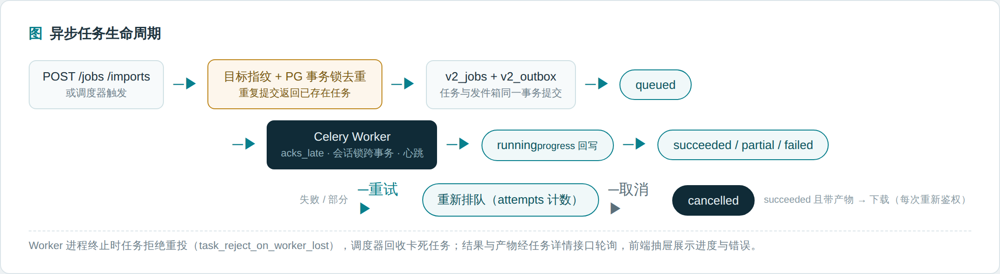

- **事务发件箱**：任务登记与业务写入同事务提交，Worker 不会因中间崩溃丢失任务；
- **目标锁去重**：同一业务目标（如同一日采集）以 PostgreSQL 事务锁去重，重复提交返回已存在任务；
- **心跳与恢复**：Worker 会话锁跨越业务事务，进程终止自动释放；调度器在心跳超过十分钟时重发，同一任务恢复已下载文件清单；
- **至少一次投递**：重投不保证消息只送一次，业务端保证同任务副作用幂等；
- **备份核验**：数据库与文件卷一起备份，`scripts/backup_platform.py verify-restore` 在独立的 `platform_restore_*` 库上逐项验证 SHA-256，绝不覆盖运行库。

# 第四部分 功能说明

## 16. 登录与账号安全


**页面要素**：左侧品牌区（蓝穹云眼 · 环境监测与执法辅助平台），右侧账号/密码表单。

**操作流程**：

1. 打开系统地址，输入管理员分配的账号与初始密码；
2. 首次登录被强制引导至"设置新的登录密码"页（下图），新密码至少 12 位，改密后需重新登录；
3. 登录失败累计达到阈值后账号临时锁定（默认 5 次 / 15 分钟，可配置）。

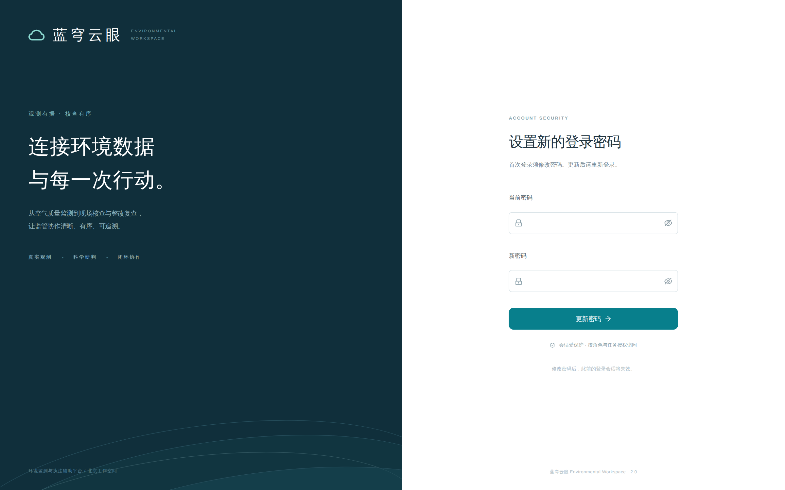

**会话安全机制**（详见图16-3）：

- 密码 Argon2 散列存储；会话 Cookie 为 HttpOnly，CSRF 令牌与 Origin 双校验；
- 退出登录、修改密码、角色调整、账号停用均立即吊销该用户全部服务端会话；
- 登录失败与越权访问写入独立审计记录，不被业务回滚撤销。

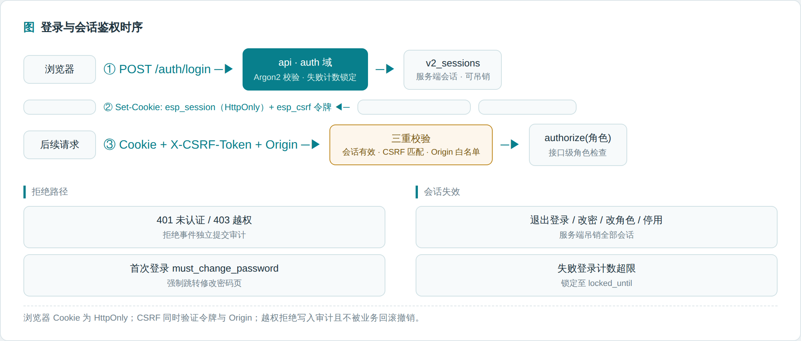

**角色矩阵**：

| 功能域 | 管理员 | 监管主管 | 执法人员 | 研究者 |
| --- | :-: | :-: | :-: | :-: |
| 工作台/监测/评价/预测/模型/报告 | ✓ | ✓ | ✓ | ✓ |
| 线索认领与登记 | ✓ | ✓ | ✓ | — |
| 任务分派/驳回线索/审核归档 | ✓ | ✓ | — | — |
| 核查执行/整改录入/证据上传 | — | — | ✓ | — |
| 企业档案查看 | ✓ | ✓ | ✓ | — |
| 企业 CSV 导入 | ✓ | ✓ | — | — |
| 采集/训练任务发起 | ✓ | — | — | — |
| 核查任务汇总导出 | ✓ | ✓ | ✓ | — |
| 标准法规维护/模型回滚 | ✓ | ✓ | — | — |
| 用户/数据源/通道/审计 | ✓ | — | — | — |

说明：执法人员仅能读取本人负责或协作的核查任务；研究者无企业证据访问权，导航中不显示监管菜单组。

## 17. 工作台

工作台为登录后首页，内容随角色变化：管理员/主管看全市态势与待办，执法人员优先看任务卡，研究者以数据质量指标替代待办卡片。


**页面要素**：

- 顶部新鲜度条：最新观测日期、入库时间、来源标识与"试运行数据源"标注；
- 指标卡组：全市当前 AQI（含首要污染物）、近 7 天优良天数（含迷你趋势）、超限评价记录、待办核查任务（研究者显示"数据不足记录"）、有效站点目录；
- 站点态势图：按各站点最近一日 AQI 着色（底图为示意占位，正式接入政务网天地图）；
- AQI 日历热力矩阵：全市均值近 5 个月逐日着色；
- 超限评价记录表：站点/日期/污染物/评价浓度/超标倍数。


执法人员视角以"我的工作"为题，核查待办卡片置顶，标注当前阶段（待核查/整改跟踪）与剩余期限天数，点击直达任务。

## 18. 监测分析


**功能定位**：按时间范围浏览站点观测趋势，识别污染过程与数据缺口。

**操作步骤**：

1. 顶栏选择观测日期范围（默认最近七天）；
2. 在筛选区切换污染物（PM2.5/PM10/SO2/NO2/O3/CO）、时间粒度（小时/日）；
3. 需要对比时在"对比站点"多选框选择最多 5 个站点，曲线叠加展示；
4. 点击趋势图上某个时点，下方明细表联动过滤至该日数据；
5. 切换到"数据质量与更新"标签，查看各污染物观测条数分布与最近文件获取记录（成功/失败与说明）。

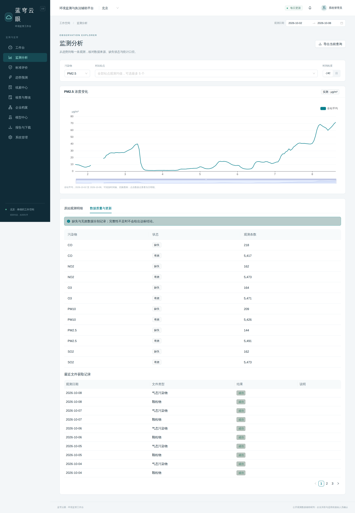

**校验规则与口径**：缺失与无效数据分别记录，明细表保留原始值、不以插补替代；完整性不足的评价不会给出达标结论。研究者视角下图18-3展示相同页面——页面一致，但导航不含监管菜单组。

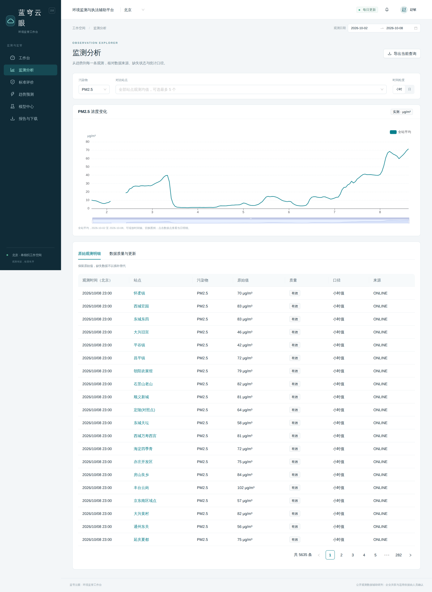

## 19. 站点详情


**页面要素**：站点编号、目录状态（启用/停用）、最近观测时间；下方内嵌该站点的监测分析视图（筛选区固定为本站点）；底部提供"查看标准评价""查看历史预测"两个跳转入口。

站点坐标、名称、编码等目录信息由管理员在系统管理中维护；坐标缺失时工作台地图不绘制该站点，绝不由前端推测位置。

## 20. 标准评价


**功能定位**：按站点×日期×污染物展示评价结果：评价浓度、适用限值、有效统计数、超标倍数与结论（超过限值/未超限/数据不足）。

**操作步骤**：

1. 按"评价结果""污染物"筛选；顶部日期范围决定查询区间；
2. 点击行首展开图标查看该评价的标准快照：标准版本、适用等级、数据口径（自然日有效小时均值/日最大8小时均值）、最低完整性要求、生效时间、官方原文链接、输入快照哈希；
3. 对超标记录点击"创建线索"，弹出"创建待研判线索"对话框——系统已自动填入站点与超标信息，补充标题与待核实事项后提交，线索进入待研判列表。

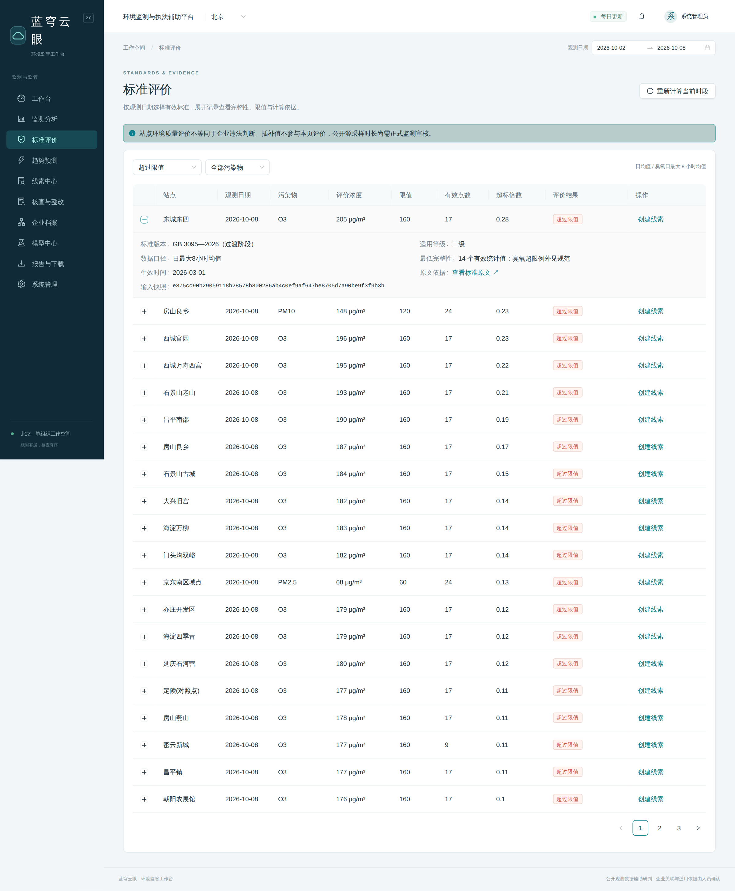

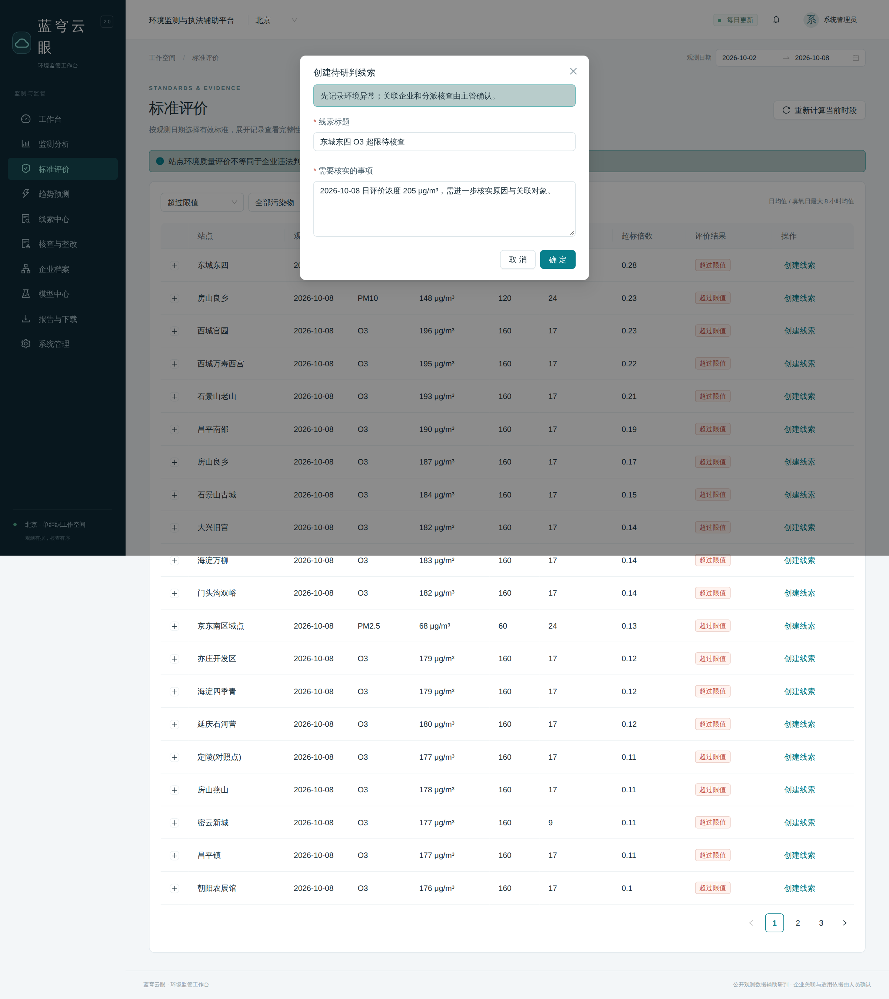

**评价口径**：默认二级标准；日均值最少 20 个有效小时；臭氧按 08:00 至次日 00:00 的 17 个滑动 8 小时窗口取日最大值，单窗口至少 6 个有效小时；2025 年数据适用 GB 3095—2012，2026 年 3 月 1 日起适用新标准过渡阶段。历史评价保留当时标准快照，标准修订不回写历史结论。

## 21. 趋势预测


**功能定位**：查看未来 24 小时颗粒物（PM2.5/PM10）预测轨迹与名义 90% 区间，可回溯历史预测批次的数据截止时间。

**操作步骤**：

1. 选择站点与污染物；下拉"最近预测批次"可回看历史批次的预测结果；
2. 预测图展示预测浓度虚线与上下区间边界，顶部标注数据截止时间与区间口径说明；
3. 点击"运行预测"创建预测任务，右侧弹出任务进度抽屉（排队→执行→完成/失败），可随时取消。

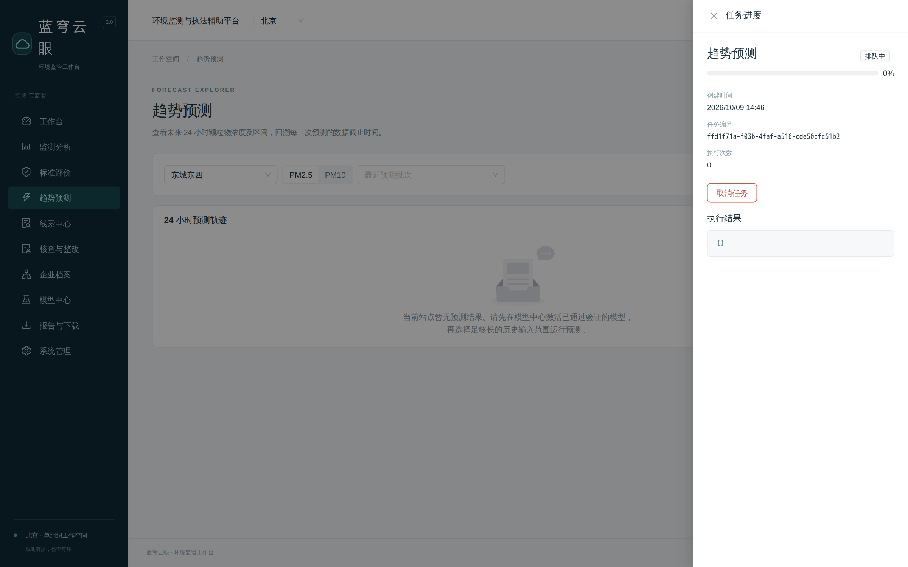

**约束**：须先在模型中心激活通过验证的模型；无预测结果时页面明确提示并给出操作指引，不展示编造曲线。预测值经验证集残差校准，不展示未经验证的污染概率。

## 22. 线索中心


**功能定位**：集中研判环境异常与人工线索，确认关联对象后安排现场核查。线索状态：待研判（pending）→ 已分派（assigned）/ 已驳回（rejected）/ 已关闭（closed）。

**操作步骤**：

1. "新建线索"登记人工线索（标题、事实与待核实事项、优先级）；由评价页创建的线索自动关联评价与站点；
2. 待研判线索可由有权限人员点击"认领"进入本人研判队列；
3. 主管点击"分派核查"：选择负责人（必填）、协作人、关联企业（经确认后填写，页面明示"环境站点异常不能自动归责企业"）、核查期限与分派说明；
4. 对不成立线索点击"驳回"并填写理由；展开行可查看完整描述与驳回理由。

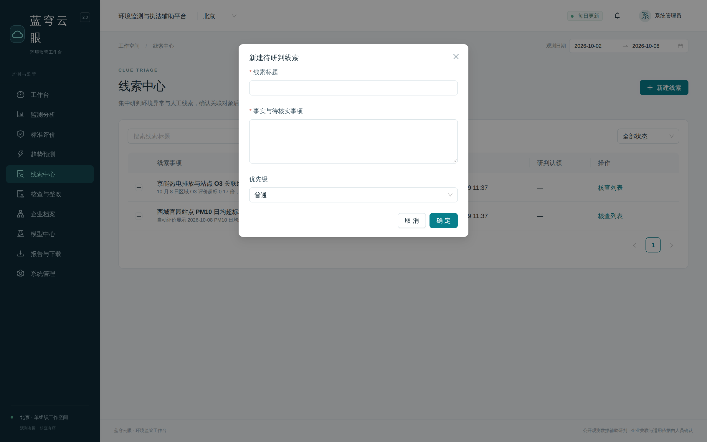

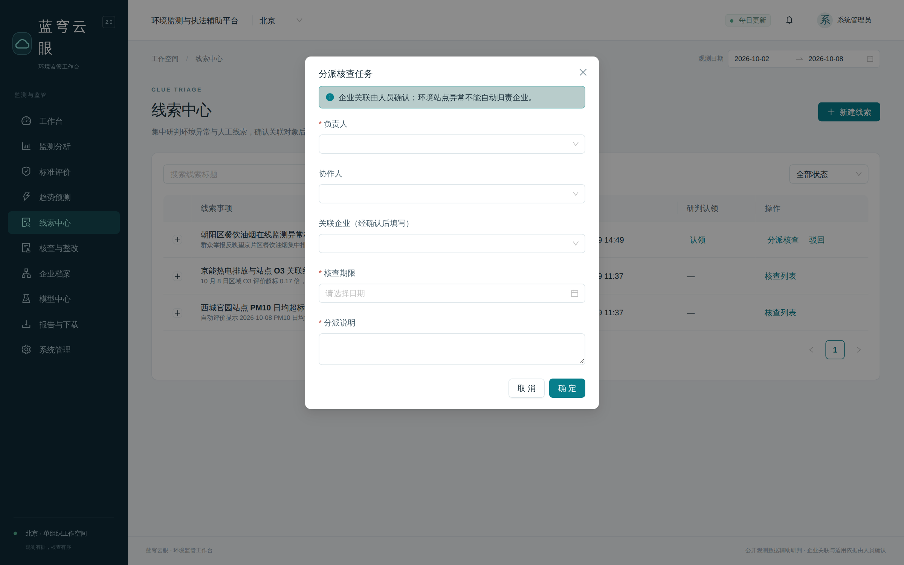

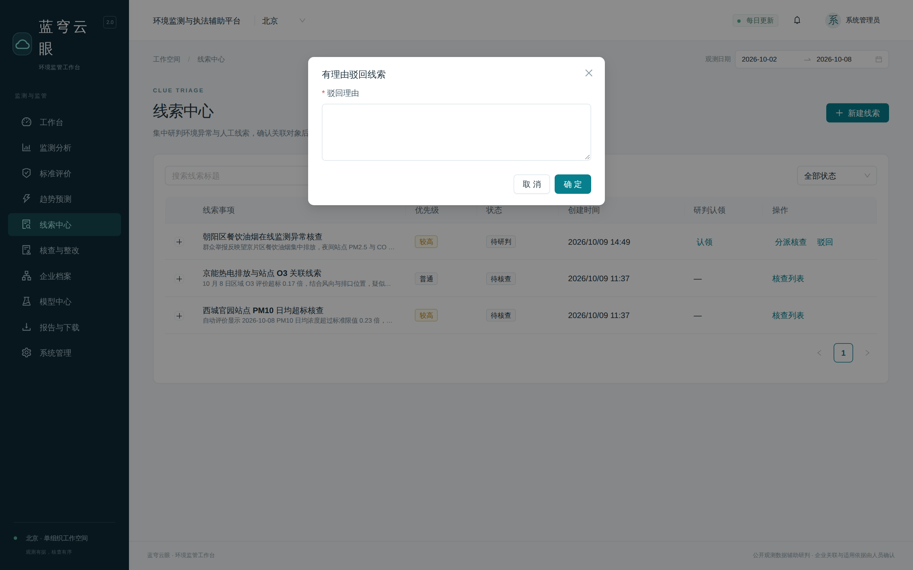

**校验规则**：仅待研判线索可分派/驳回/认领；认领冲突时后者收到冲突提示；负责人、核查期限、分派说明为必填。

## 23. 核查与整改


任务列表支持标题搜索与阶段筛选；逾期未完成任务的期限以红色标注。执法人员视角（图23-2）仅见本人负责或协作的任务。

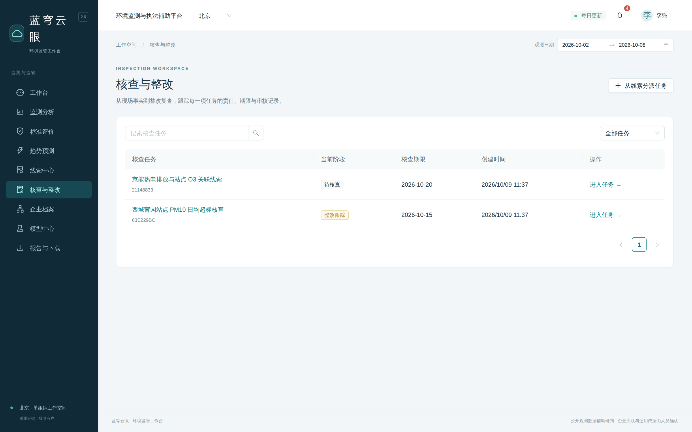

**状态机**（服务端强制流转）：


**详情页结构**（图23-4）：顶部步骤条显示当前阶段；左列依次为"现场核查记录"（核查事实表单 + 可增删的关联适用依据）、"整改事项与复查"、"证据与附件"；右栏为任务时间线与闭环说明。


**操作步骤**：

1. 主管分派后任务处于"待核查"；负责人点击"开始现场核查"进入核查阶段；
2. 录入核查事实（≥5 字），按需"添加依据"——每条适用依据须选择法规库中的真实法规记录，并填写具体条款与适用理由；点击"保存核查记录"落库，表单携带版本号，他人已更新时收到冲突提示；
3. 存在违法事实时"添加整改事项"（整改要求与期限必填），再点击"进入整改跟踪"；无违法事实时可"无需整改，提交审核"直达主管审核；
4. 整改阶段逐项"填写整改反馈"；进入复查后逐项记录复查结论并勾选"已核实该项整改完成"；全部整改核实后方可"提交主管审核"；
5. 主管审核通过归档，或"退回补充核查"回到现场核查阶段；归档任务可由主管"重新开启核查"；
6. 全程可上传证据附件（图片/PDF/Office/CSV/TXT），保存原文件、上传时间与 SHA-256，"追加版本"保留此前文件。

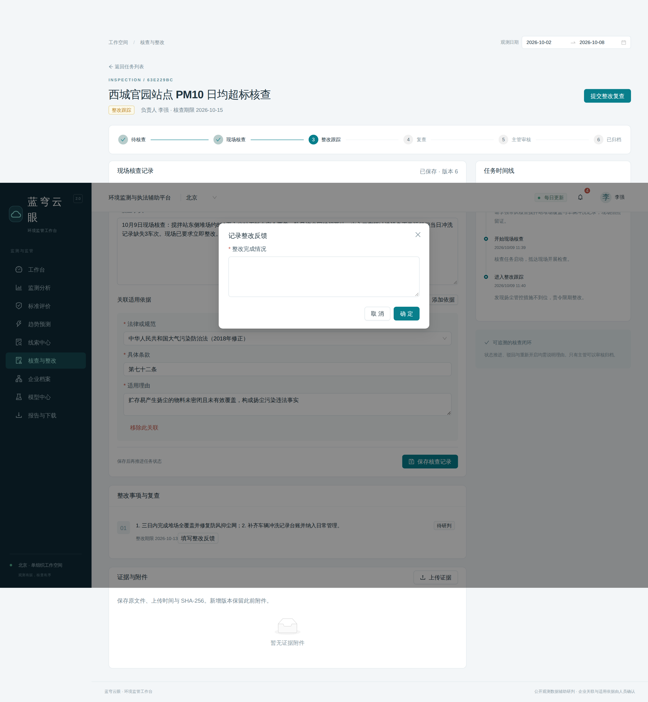

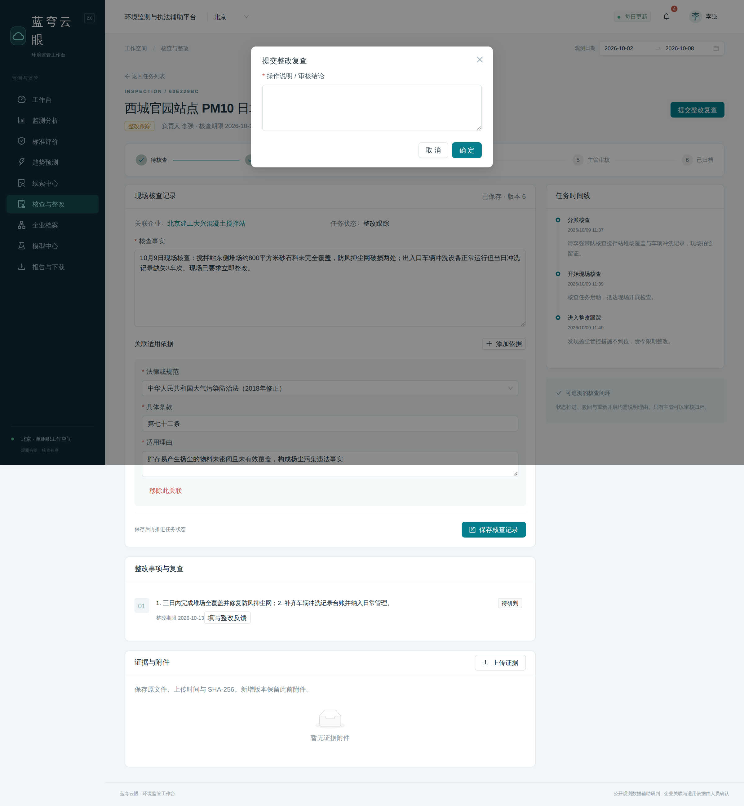

**服务端校验**：审核或归档状态不可编辑；仅现场核查阶段可添加整改事项；整改反馈与复查结论按阶段分别要求；每次状态流转须填写操作说明/审核结论（≥5 字）并携带版本号，旧版本返回 409。

## 24. 企业档案


**操作步骤**：

1. "新建企业"登记档案（企业名称必填，统一社会信用代码校验 18 位格式，行业/地址/联系人可选）；
2. 管理员与主管可使用"CSV 导入"批量登记，先下载页面提供的导入表头模板；
3. 点击企业名称进入详情：基础资料、排放口与许可证两类专项资料卡、历史核查与整改列表、档案附件。


**权限**：研究者无企业档案访问权；执法人员可查看与本人任务关联的企业；导入仅限管理员/主管。

## 25. 模型中心


**功能定位**：管理预测与插补模型的实验、验证与发布。

**页面要素**：两张任务卡分别对应"浓度预测"与"离线插补"——显示当前激活模型（算法、发布时间）并提供"运行24小时预测/运行辅助插补"与"回滚版本"入口；下方"实验与版本"表列出全部模型（算法、验证指标、制品状态）；管理员可"创建训练任务"。

**发布机制**：训练/验证/测试按时间 70%/15%/15% 隔离，归一化只拟合训练集；候选模型未达到基线时保留实验状态不自动发布；模型制品记录输入矩阵、代码哈希、随机种子、特征与环境指纹，激活与回滚均留审计。

## 26. 报告与下载


**功能定位**：异步生成数据报告、执行数据导入与手工补采、追踪任务运行记录。

**操作步骤**：

1. "生成数据报告"卡：选择报告内容（原始环境观测；核查任务汇总对非研究者开放）与格式（CSV 数据交换 / Excel 含来源说明），点击"创建导出任务"；
2. "数据导入与采集"卡（管理员/主管）：选择导入内容（颗粒物日文件/气态污染物日文件/企业档案表格）后上传 CSV；管理员另可"补采当前日期范围"触发在线采集；
3. "任务运行记录"表：按状态筛选，查看进度条与执行次数；失败或部分完成的任务可"重试"；带产物的任务可"下载"（每次下载重新鉴权）。

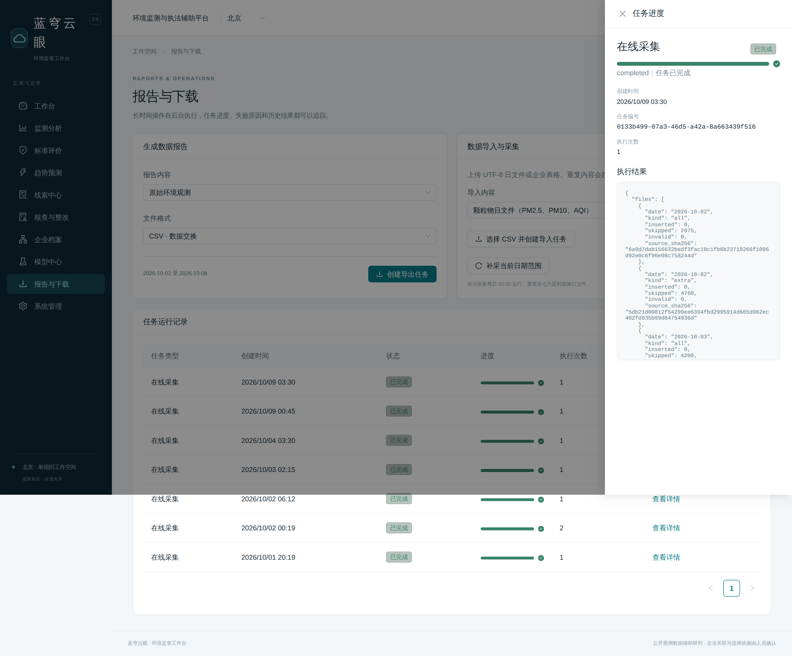

**口径**：导出内容绑定生成时刻的数据口径与来源文件指纹；任务列表每角色仅见本人有权查看的任务。

## 27. 通知中心

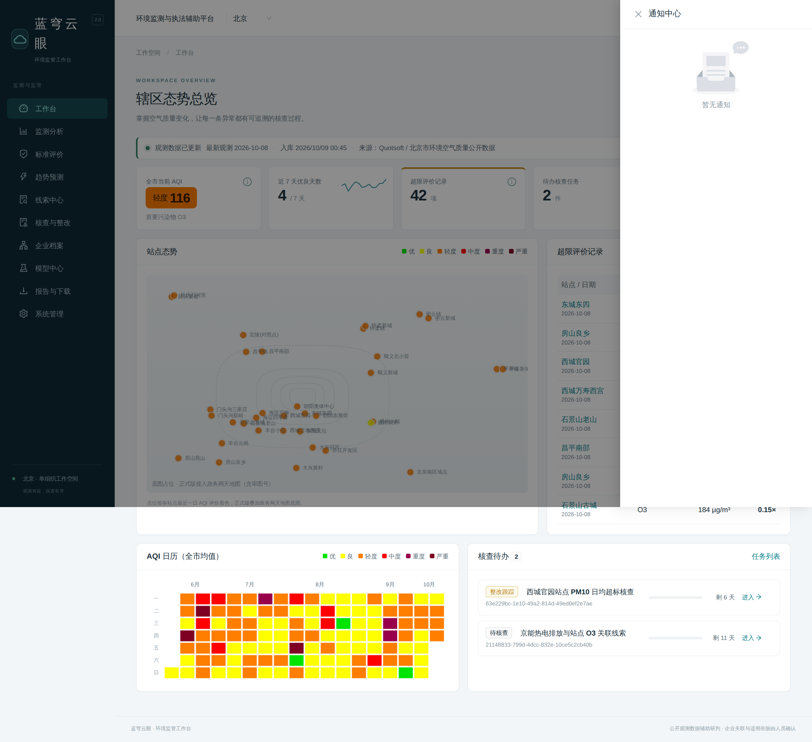

顶栏铃铛显示未读数，点击打开"通知中心"抽屉：站内通知列表（标题、正文、时间），点击单条标记已读并跳转关联页面。任务分派、审核退回等事件自动产生站内通知；管理员可在系统管理中配置邮件/Webhook 外部通道。

## 28. 系统管理

仅管理员可见。五个分区：

**用户与权限**（图28-1）：账号目录（姓名/登录名/角色/启停/首次改密状态），角色下拉即改即生效并吊销会话，"新建账号"设定初始密码（首次登录强制修改）。不能禁用或降级当前管理员。

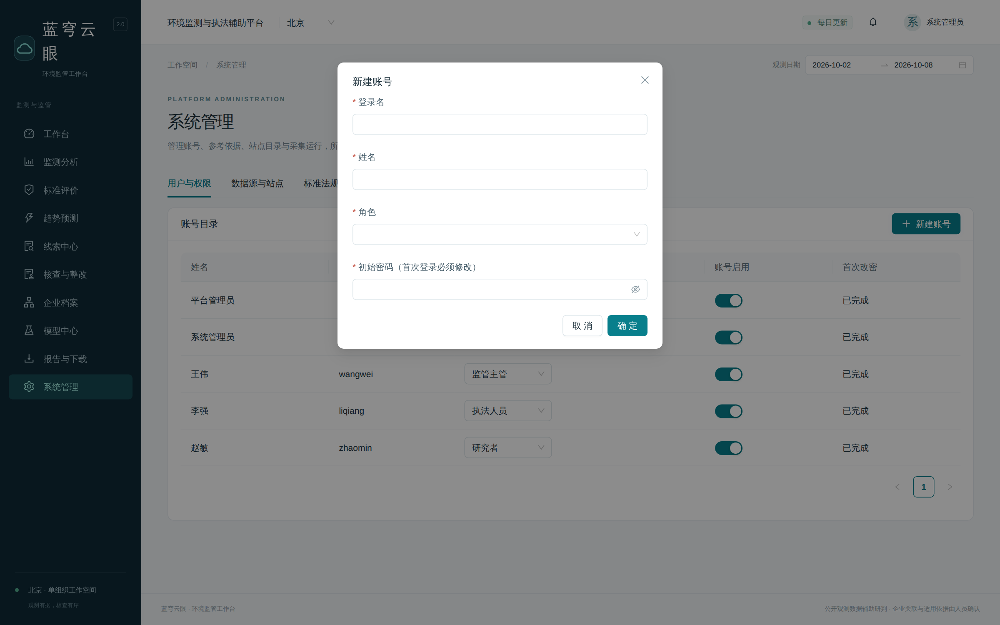

**数据源与站点**（图28-2）：来源信息卡（更新频率、许可状态徽标、来源说明链接、数据规则）、来源文件清单（观测日期/文件类型/来源/入库时间/有效修订/观测数量）、站点目录维护（编辑资料、添加有效期别名）与原始目录概览。


**标准法规**（图28-3）：环境质量标准（版本/污染物/等级/口径/限值/生效与截至日期/原文链接，可新增版本、维护截至日）与法规依据库（名称/适用地区/有效期/摘要展开）。历史评价与核查中的快照不受版本维护影响。

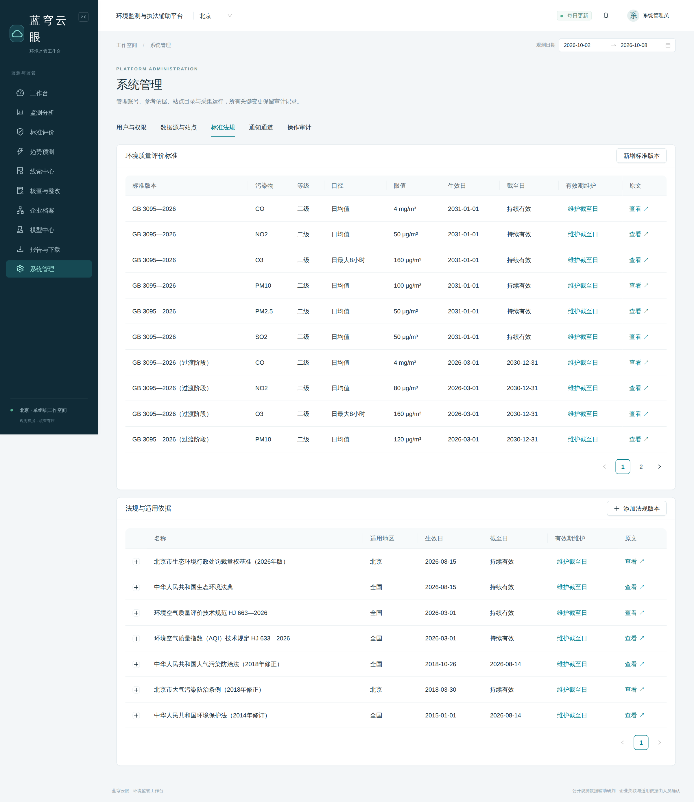

**通知通道**（图28-4）：Webhook/邮件两类通道，启用开关与发送历史（状态、尝试次数、失败原因）；凭据只填 `ESP_NOTIFY_` 环境变量名，页面不接受明文密码或令牌。

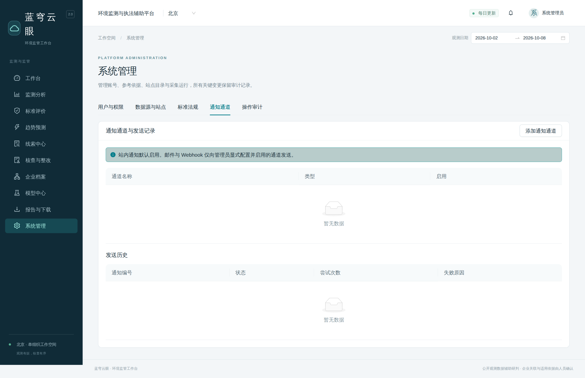

**操作审计**（图28-5）：不可变审计流水（时间/操作/对象类型/对象编号/请求编号），展开行查看结构化明细 JSON。

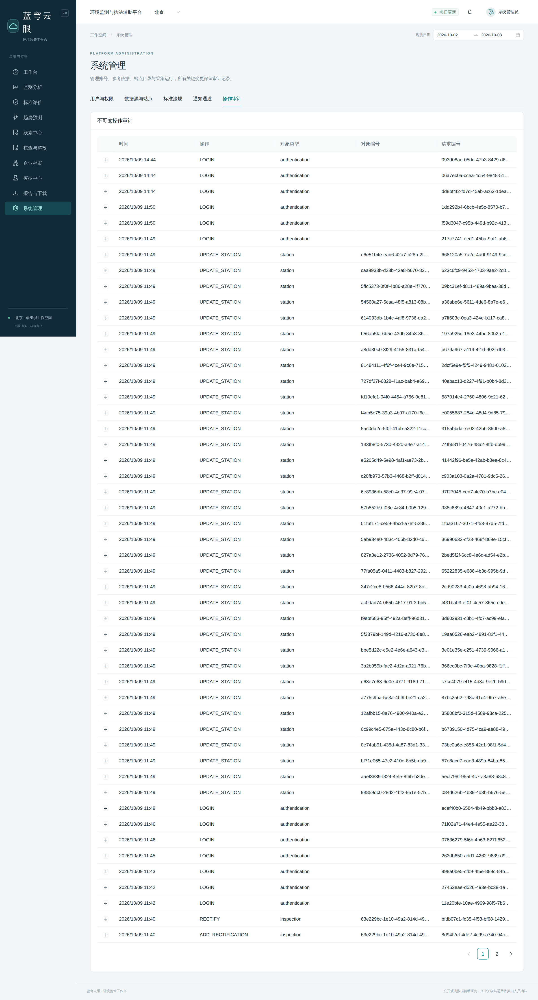

## 29. 领导驾驶舱大屏（原型示意）

大屏面向 1920×1080 展示场景设计：左侧指标与趋势、中央站点地图与回放、右侧排行与预警滚动；只读、定时刷新、多视图轮播。下图为设计原型示意，正式大屏将随政务网天地图服务接入实施，站点坐标已具备（见附录数据字典）。


# 第五部分 数据溯源与安全

## 30. 数据源策略与适配层

采集层位于适配器边界之后：业务任务只依赖 `CollectionPort` 接口，具体数据源由 `resolve_adapter(ESP_SOURCE_PROVIDER)` 显式选择。

| source key | 适配器 | 状态 |
| --- | --- | --- |
| `quotsoft` | QuotsoftAdapter | 现役：日频宽表 CSV（date,hour,type + 站点列），UTF-8/-SIG，SHA-256 指纹，修订不覆盖，重复站点与重复时刻校验 |
| `official` | OfficialSourceAdapter | 已注册、显式拒绝执行，待官方接口规范到达后实现 |

原则：正式官方模式绝不静默回退到 Quotsoft；未知 source key 直接拒绝任务。日文件按"颗粒物（all）/气态污染物（extra）"两类，保留署名、来源地址、获取时间与历次修订；404 与错误格式保留记录而不复制填补。

## 31. 数据源许可门禁


启用任一数据源须同时满足：部署开关 `ESP_SOURCE_LICENSE_CONFIRMED=true`，且确认文件 `var/platform/source-license-confirmation.json` 有效。确认文件字段：provider、record_id、confirmed_by、确认时间、scope、evidence_sha256、reference、valid_until。

规则：

- scope 取 `trial_operation`（试运行，必须带 valid_until）或 `continuous_business_use`（正式授权）；
- valid_until 到期后**所有环境**一律阻断采集；
- 文件 provider 须与当前数据源一致，防止 Quotsoft 授权冒名官方接口；
- 确认时间不晚于当前时间，杜绝事后补造；
- 门禁统一作用于 HTTP 任务提交、CLI、调度器、Worker 执行与 `/admin/sources` 展示（返回 ok/unconfigured/blocked 三态）。

## 32. 数据可信度与口径

**存储口径**：小时浓度、来源 AQI、滚动 24 小时值、滚动 8 小时值与滚动最大值分别标记存储；CO 用 mg/m³，其余用 μg/m³；瞬时值统一存 UTC，页面按北京时间展示；来源 AQI 聚合只取最大值，不求均值充当 AQI。

**可信度标识**：

| 标识 | 含义 | 系统表现 |
| --- | --- | --- |
| 实测 | 原始观测，绑来源文件指纹 | 明细表原始值，图表实线 |
| 派生 | 插补/预测写入 v2_derived_values | 预测页虚线与区间带，标注批次与截止时间 |
| 缺失 | 该时段无数据 | 明细与图表如实留空，不以插补替代 |
| 已修订 | 来源文件出新修订，旧版保留 | 来源文件清单可见"当前/历史保留" |
| 数据不足 | 不满足标准完整性要求 | 评价结论为"数据不足"，不作达标结论 |

## 33. 安全机制

- 会话 Cookie HttpOnly，CSRF 令牌与 Origin 双校验，非浏览器请求按无 Origin 另行处理；
- 口令 Argon2 散列，失败计数锁定（默认 5 次锁 15 分钟），改密/改角色/停用即吊销全部会话；
- 越权拒绝与登录失败独立提交审计，不被业务回滚吞掉；
- 全局页面水印（姓名 + 登录名 + 当日日期），震慑截图外发；
- 附件与导出文件私有存储，每次访问重新鉴权，不经静态目录暴露；
- 错误响应统一 `code/message/details/request_id`，不泄露 SQL、路径与密钥；日志经敏感信息过滤器；
- Nginx 安全响应头：CSP、nosniff、frame-ancestors、Referrer-Policy；
- 通知通道凭据仅引用 `ESP_NOTIFY_*` 环境变量名，页面不接受明文秘密。

# 第六部分 运维与验收

## 34. 初始化与配置

平台按单组织部署，`compose.platform.yml` 运行 PostgreSQL、Redis、迁移进程、API、Worker、模型 Worker、调度器和 Nginx。流程：

```powershell
python scripts/configure_platform.py            # 生成随机 .env（不覆盖已有）
docker compose -f compose.platform.yml up -d --build
docker compose -f compose.platform.yml exec api python -m app.cli create-admin --username admin
```

要点：`POSTGRES_PASSWORD` 与 `ESP_SECRET_KEY` 必须长期保存；`.env` 不提交版本库；生产须设 `ESP_ENVIRONMENT=production`、`ESP_COOKIE_SECURE=true`、`ESP_PUBLIC_ORIGIN` 为准确公开 Origin，TLS 在部署网关终止；在线来源许可确认后设 `ESP_SOURCE_LICENSE_CONFIRMED=true` 并保存确认文件。

## 35. 日常运维与脚本工具

| 脚本 | 用途 |
| --- | --- |
| `configure_platform.py` | 生成初始 `.env` 配置 |
| `prepare_acceptance.py` / `verify_acceptance.py` | 隔离验收环境初始化与核验 |
| `online_acceptance_report.py` | 七天在线验收窗口只读报告 |
| `backup_platform.py` | 备份与 `verify-restore` 恢复演练 |
| `validate_deployment.py` | 空库部署验证 |
| `validate_worker_recovery.py` | Worker 中断恢复与幂等验证（独立队列/Redis DB 2） |
| `validate_model_pipeline.py` / `validate_real_models.py` | 模型制品链路与真实小规模验证 |
| `benchmark_platform.py` | 50 并发、千万行隔离性能基线（test_* schema，不写生产库） |
| `check_locks.py` | 依赖锁一致性检查 |
| `seed_station_coordinates.py` | 站点目录坐标初始化/更新 |
| `read_reference_pdfs.py` | 参考文件解析 |

## 36. 备份与恢复演练

数据库和附件必须一起备份——文件为不可变内容寻址制品，脚本先做 PostgreSQL 一致性转储，再归集全部引用文件、模型权重和数据快照：

```powershell
python scripts/backup_platform.py backup .artifacts/backups/<日期>
python scripts/backup_platform.py verify-restore .artifacts/backups/<日期>
```

`verify-restore` 只创建新的 `platform_restore_*` 数据库与 `restored-files-*` 目录，重新导入、解包文件、逐项验证 SHA-256，并确认恢复库引用的源文件、证据和模型均存在，绝不覆盖运行库。真实灾备切换：停写与调度 → 验证备份 → 新卷恢复 → 切换连接与存储根 → 启动 → 验证登录、受保护下载、模型制品与任务恢复。不得删除原卷尝试恢复。

## 37. 升级与回退

先完成备份恢复演练，再构建新镜像并运行迁移服务。Alembic 版本表为 `v2_alembic_version`，首版 DDL 已冻结，后续修订使用独立迁移；HTTP 进程不执行建库与自动管理员创建；迁移失败应停止切换。回退使用旧镜像及经过验证的升级前备份，保留升级后数据以便核对；禁止强制降级或删除模型文件处理失败，模型切换另有指针回滚。

## 38. 验收流程与检查清单

**隔离验收环境**：`compose.acceptance.yml` 叠加层使用独立 PostgreSQL `acceptance` schema、Redis DB 1 与独立附件目录；固定验收账号（admin/supervisor/officer/researcher）仅运行于隔离库，初始化程序拒绝在正式库执行。

**七天在线验收**：每日核对计划任务执行、两类源文件到达、缺档、补采、版本修订、通知结果与备份证据；记录起止时间与实际故障。禁止把一次启动成功当作七天验收完成；正式签署要求 `backup_gate_passed=true`。

**签署前检查清单**：

- [ ] 后端回归、契约、平台、前端、浏览器验收套件全部通过（见第 41 章证据清单）
- [ ] 七天在线窗口报告完整，故障与修订已记录
- [ ] 数据源授权确认文件有效，`ESP_SOURCE_LICENSE_CONFIRMED=true`
- [ ] 备份恢复演练通过且报告归档
- [ ] 生产配置项按第 13 章清单核对（HTTPS、Cookie Secure、公开 Origin）
- [ ] 模型制品经评审激活，或未激活时预测页如实显示暂无结果

# 第七部分 接口与非功能

## 39. API v2 契约摘要

- 分页：`page_number`/`page_size`，返回 `items,total,page,page_size,request_id`，稳定主键排序；
- 异步任务：`POST /jobs`、`POST /imports` 返回 202 + `job_id`；`GET /jobs/{id}` 查状态/进度/结果，`POST .../retry`、`/cancel` 运维操作，`GET .../download` 下载产物；
- 时间口径：北京时间自然日入参（上限 731 天），观测瞬时值存 UTC；
- 幂等：任务提交按目标指纹+PG 事务锁去重；通知按幂等键；核查修改携带版本号；
- 文档：运行时 `/api/v2/docs`（OpenAPI），前端类型由契约生成并在测试中校验一致；
- 接口清单共 62 个操作，详见技术附录册附录 A。

## 40. 错误码表

| code | HTTP | 场景示例 |
| --- | --- | --- |
| INVALID_REQUEST | 400 | 接口不存在、方法或参数无效 |
| INVALID_TIME_RANGE | 400 | 起止日期颠倒或非法 |
| TIME_RANGE_EXCEEDS_LIMIT | 400 | 查询跨度超过 731 天上限 |
| UNAUTHENTICATED | 401 | 未登录或会话已吊销 |
| INVALID_CREDENTIALS | 401 | 账号密码错误（含锁定） |
| FORBIDDEN | 403 | 角色不足、非任务归属人员、Origin 不匹配 |
| NOT_FOUND | 404 | 记录不存在或无权可见 |
| NO_MATCHING_DATA | 404 | 指定条件无数据 |
| CONFLICT | 409 | 版本过期、线索已处理、状态不支持该操作、记录重复 |
| VALIDATION_ERROR | 422 | 输入内容校验失败（附字段级 details） |
| RATE_LIMITED | 429 | 触发频率限制 |
| SERVICE_UNAVAILABLE | 503 | 依赖服务暂时不可用 |
| CONFIGURATION_ERROR | 503 | 部署配置缺失或错误（如许可门禁阻断） |
| CHINESE_FONT_UNAVAILABLE | 503 | 导出渲染缺少 CJK 字体 |

## 41. 非功能指标与验证记录

| 项 | 结果 |
| --- | --- |
| 后端完整回归 | Docker 测试镜像 239 passed / 0 skipped（含 Linux CJK 导出、许可门禁、备份门禁、JobKind 契约、编码伪影检查） |
| 重构契约与领域模型 Schema | 33 passed |
| Docker 平台验收 `platform_tests` | 25/25 passed（含生产采集授权保护） |
| 前端单元测试 | Vitest 5/5 passed |
| 前端生产构建 | TypeScript/Vite 构建通过（存在 >500kB chunk 告警，列入优化项） |
| 浏览器验收 | Playwright 桌面+平板 8/8 passed |
| OpenAPI 兼容 | 运行时契约与前端生成文件完整对象相等 |
| 性能基线 | 千万行隔离库：列表 P95 657ms，工作台 P95 686ms |
| 类型检查 | mypy 严格模式 86 文件零告警；前端 tsc 通过 |
| 数据规模 | 试运行库约 798 万条观测、35 个站点 |
| 备份恢复 | `verify-restore` 逐项 SHA-256 核验通过（证据见 .artifacts/） |
| 模型验证 | seasonal、interpolation 基线已通过；其余候选保持未激活状态 |

# 第八部分 常见问题与后续计划

## 42. 常见问题

**为什么页面上某项显示"暂无数据"？** 系统不虚构生产值：无观测、无评价、未激活模型或角色无数据权限时如实显示空态。

**为什么提交提示"记录已被其他人更新"？** 核查等记录携带版本号防止并发覆盖，刷新页面取得最新版本后重试。

**采集任务被许可门禁阻断怎么办？** 检查 `ESP_SOURCE_LICENSE_CONFIRMED` 与确认文件：provider 是否匹配当前数据源、scope 是否覆盖用途、valid_until 是否过期、evidence_sha256 是否对应佐证文件。过期授权须重新签署登记。

**为什么预测页没有结果？** 需先在模型中心由管理员激活通过验证的模型，再运行预测任务；未激活时系统明确提示而非展示编造曲线。

**附件打不开/下载失败？** 附件每次访问重新鉴权：确认登录状态与任务归属权限；归档/审核中的任务附件只读。

**地图上有站点缺位？** 站点坐标属目录参考数据，由管理员在"系统管理→数据源与站点"维护或部署脚本初始化；缺失坐标的站点不绘制，不由前端推测位置。

## 43. 试运行到正式运行路线图

1. 试运行期（当前）：Quotsoft 数据源 + `trial_operation` 授权（带 valid_until）+ 单部门使用 + 七天在线验收窗口；
2. 接入准备：获取官方监测接口规范，实现 `OfficialSourceAdapter`（注册表已占位，无自动回退）；
3. 切换授权：签署 `continuous_business_use` 授权并更新确认文件，`ESP_SOURCE_PROVIDER=official`；
4. 政务云部署：拓扑平移、出网白名单、等保测评、托管数据库/缓存、对象存储；
5. 大屏正式化：接入政务网天地图底图，替换示意占位；
6. 持续迭代：按验收反馈迭代功能，数据字典与接口附录由脚本随版本再生。

# 附录

## 附录 A 截图索引

| 编号 | 图 | 说明 |
| --- | --- | --- |
| m01 | 登录页 | 蓝穹云眼品牌登录 |
| m02/m15/m18 | 工作台×3 | 管理员/执法人员/研究者视角 |
| m03/m19/m20 | 监测分析 | 趋势对比/研究者视角/数据质量 |
| m04 | 站点详情 | 目录信息与嵌入监测视图 |
| m05/m21/m22 | 标准评价 | 列表/标准快照展开/创建线索弹窗 |
| m06/m35 | 趋势预测 | 页面与任务进度抽屉 |
| m07/m23/m24/m25 | 线索中心 | 列表/新建/分派/驳回 |
| m08/m16/m17/m26/m27/m28 | 核查与整改 | 列表/详情/执法视角/整改反馈/流转弹窗 |
| m09/m10 | 企业档案 | 列表与详情 |
| m11 | 模型中心 | 激活、回滚与实验列表 |
| m12/m36 | 报告与下载 | 页面与任务详情抽屉 |
| m13/m14/m29/m30/m31/m32 | 系统管理 | 总览/数据源/标准法规/通道/审计/新建账号 |
| m33 | 修改密码 | 首次登录强制改密 |
| m34 | 通知中心 | 抽屉式通知列表 |
| fig-* | 架构图×8 | 分层/部署/数据流/状态机/许可门禁/ER/鉴权/任务生命周期 |
| proto-screen | 大屏 | 原型示意 |

## 附录 B 版本与变更记录

| 版本 | 日期 | 内容 |
| --- | --- | --- |
| v2.0 | 2026-10 | v2 模块化重构；蓝穹云眼设计系统落地；采集适配器与许可门禁；35 站点坐标建库；本说明书初版 |
| v2.0 扩写版 | 2026-10 | 按正式系统实况修正功能描述；补齐操作步骤截图、8 张架构图、运维验收章节与错误码表；技术内容移至附录册 |
