# 第一部分 概述

## 1. 建设背景与目标

蓝穹云眼·环境监管工作台是一套面向生态环境主管部门的环境监测与执法辅助平台。平台以城市空气质量自动监测数据为基础，将"观测—评价—线索—核查—整改—复核—归档"各环节纳入统一系统管理，解决监测数据分散、异常发现滞后、核查过程不可追溯、数据来源难以说明等问题。

本期建设目标：

- 在一个政府部门内开展试运行，覆盖日常监测分析、标准评价、线索管理、核查整改闭环、报告导出与系统管理等核心功能；
- 建立完整的数据溯源体系：每一条观测数据可追溯至原始来源文件及其 SHA-256 指纹，每一次评价可追溯至评价时生效的标准快照；
- 建立数据源许可门禁机制：试运行期间使用 Quotsoft 公开数据须留存可审计的授权确认记录，正式运行须接入官方监测接口；
- 为政务云正式部署预留架构与接口位置，业务链路不因数据源切换而改动。

## 2. 系统定位与边界

**系统定位**：辅助研判工具。平台提供超标识别、线索归集、核查流转、整改跟踪与留档能力，为监管决策和执法准备提供数据支撑。

**边界声明**：

- 公开观测数据辅助研判；企业关联与适用依据由执法人员确认，系统不自动作出处罚结论；
- 核查、整改、复核各环节的法律适用性判断由责任人作出，系统负责流程约束与留痕；
- 预测结果为模型辅助产出，页面明确标注为预测值，不作为执法依据；
- 试运行期间数据源为 Quotsoft 公开镜像，正式运行将直接接入官方监测接口，二者不可混用。

## 3. 术语与数据口径

| 术语 | 说明 |
| --- | --- |
| 观测数据 | 站点每小时上报的污染物浓度原始值，入库存 UTC，页面按北京时间展示 |
| 评价记录 | 依据现行有效标准对站点某日某污染物的浓度评价结果，含超标倍数 |
| AQI | 空气质量指数，按国家标准六级：优/良/轻度/中度/重度/严重 |
| 线索 | 由超标评价或人工登记产生的待核查事项，可分派为核查任务 |
| 核查任务 | 执法闭环载体，状态机驱动：已分派→现场核查→整改→复查→审核→归档 |
| 来源文件 | 一次采集下载的原始文件，含 SHA-256 指纹，修订不覆盖历史版本 |
| 实测/插补/预测 | 数据可信度三级标识：实测为原始观测；插补为缺失补齐；预测为模型产出 |
| 许可门禁 | 数据源使用的授权确认机制，试运行须登记有效授权证据后方可启用 |

# 第二部分 总体架构

## 4. 架构总览

平台采用模块化单体架构。FastAPI 应用承载同步业务事务与查询接口；Celery 工作进程处理采集、导入、评价、训练、预测、插补与导出等耗时任务；独立调度器负责计划任务；PostgreSQL 为唯一业务数据库，Redis 承担消息代理与协调；Nginx 同源提供前端静态资源与 `/api/v2` 反向代理，浏览器无需处理跨域。

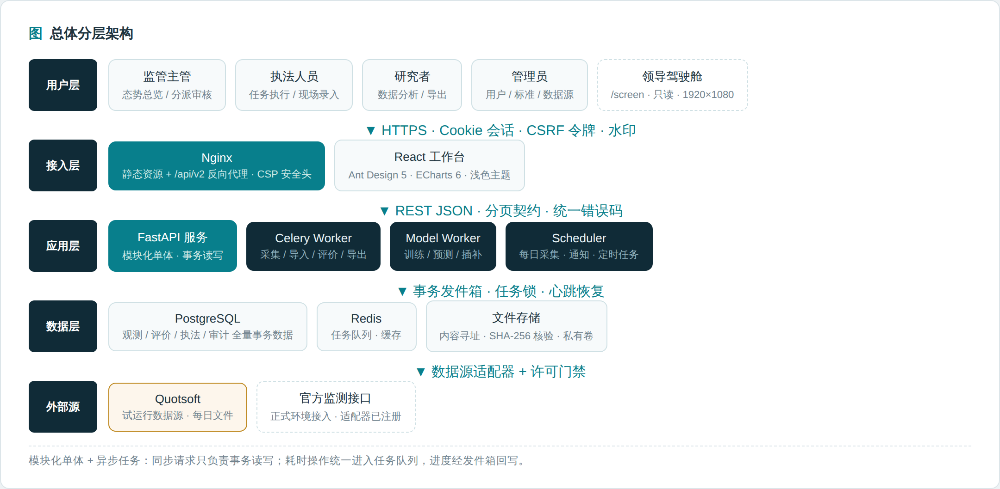

## 5. 模块边界

后端按业务域组织于 `app/v2/domains`，模块间通过端口/服务接口协作，禁止跨域直写数据表。

| 模块 | 责任 |
| --- | --- |
| auth | Argon2 口令散列、会话 Cookie、CSRF 校验、会话吊销、失败计数锁定与拒绝审计 |
| monitoring / collection | 城市站点目录、原始文件修订、时序与质量查询、数据源适配 |
| evaluation / seed | 标准有效期管理、完整性判定、站点日评价与 AQI 计算 |
| jobs / scheduler | 任务事务、事务发件箱、队列派发、心跳、恢复与计划调度 |
| datasets / forecasting / imputation / ml | 数据快照、隔离训练、原尺度评估、模型制品与推理 |
| enforcement | 企业档案、线索认领、任务归属、核查整改状态机、附件 |
| admin / notifications | 用户、标准法规、数据源、模型维护、站内及外部通知 |
| storage / exports / backup | 私有内容寻址文件存储、受控导出、备份核验 |

## 6. 核心数据流

主链路：调度器按计划下发采集任务 → 工作进程经适配器获取来源文件 → 文件指纹登记为不可变 SourceFile → 观测数据入库并标记修订关系 → 评价引擎按现行标准产出评价记录 → 超标记录进入线索池 → 分派生成核查任务 → 执法人员执行现场核查/整改/复核 → 主管审核归档。

旁路：训练与预测任务读取观测快照，产出写入 DerivedValue，不触碰原始证据；插补同样走独立通道，页面以不同视觉标识区分。

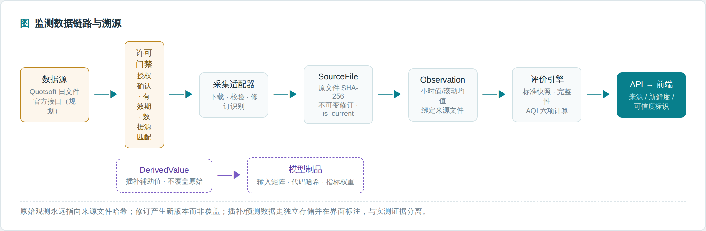

## 7. 技术选型

| 层 | 选型 | 说明 |
| --- | --- | --- |
| 前端 | React 19 + Ant Design v5 + Vite | 官方 React 19 兼容补丁；自主设计令牌体系 |
| API | FastAPI + SQLAlchemy 2.x | OpenAPI 自动生成接口文档与前端类型 |
| 任务 | Celery + Redis | `io` 队列、延迟确认、进程终止拒绝重投 |
| 数据库 | PostgreSQL | 事务发件箱、行级目标锁、审计独立提交 |
| 部署 | Docker Compose / Nginx | 七服务拓扑，政务云可平移至 K8s 或 ECS 组合 |
| 质量 | pytest 66 用例 + mypy 严格模式 86 文件零告警 + tsc + vitest | 前后端均有自动化验证 |

# 第三部分 部署架构

## 8. 服务拓扑

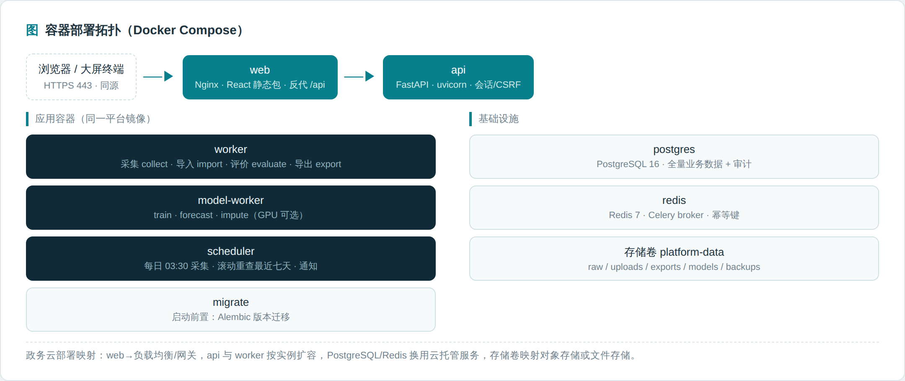

| 服务 | 职责 |
| --- | --- |
| web | Nginx：静态资源 + `/api/v2` 反代 + 安全响应头 |
| api | FastAPI 业务接口与事务 |
| worker | Celery 采集/导入/评价/导出等 IO 型任务 |
| model-worker | 训练/预测等模型任务，独立镜像隔离重依赖 |
| scheduler | 计划调度器，每日 03:30（Asia/Shanghai）采集并回查最近七天 |
| postgres | 业务数据、审计、会话、任务状态 |
| redis | Celery 代理、会话协调、分布式锁 |

## 9. 政务云部署规划

现有 Compose 拓扑向政务云映射要点：

- **出网策略**：试运行采集需访问 Quotsoft 公网地址；正式接入官方接口后按接口位置收敛出网白名单，涉密/等保环境下可改为前置机摆渡；
- **等保要点**：会话 HttpOnly + CSRF + Origin 双校验已具备；政务云侧需补充堡垒机、日志集中、漏洞扫描与等级测评流程；
- **信创适配**：应用栈全部开源组件，数据库可平移至人大金仓/达梦（SQLAlchemy 方言层隔离），操作系统可换统信/麒麟；
- **扩缩容**：api 无状态可多副本；worker 按队列横向扩展；postgres/redis 建议采用政务云托管高可用实例。

## 10. 任务可靠性与备份恢复

- **事务发件箱**：任务登记与业务写入同事务提交，Worker 不会因中间崩溃丢失任务；
- **目标锁去重**：同一业务目标（如同一日采集）以 PostgreSQL 事务锁去重，重复提交返回已存在任务；
- **心跳与恢复**：Worker 会话锁跨越业务事务，进程终止自动释放，卡死任务由调度器回收；
- **备份核验**：数据库与私有文件卷独立备份，`scripts/` 提供恢复核验脚本；验收手册含恢复演练步骤。

# 第四部分 功能说明

## 11. 登录与角色权限

平台采用会话 Cookie 认证，登录失败计数锁定，首次登录强制修改口令。密码散列使用 Argon2。

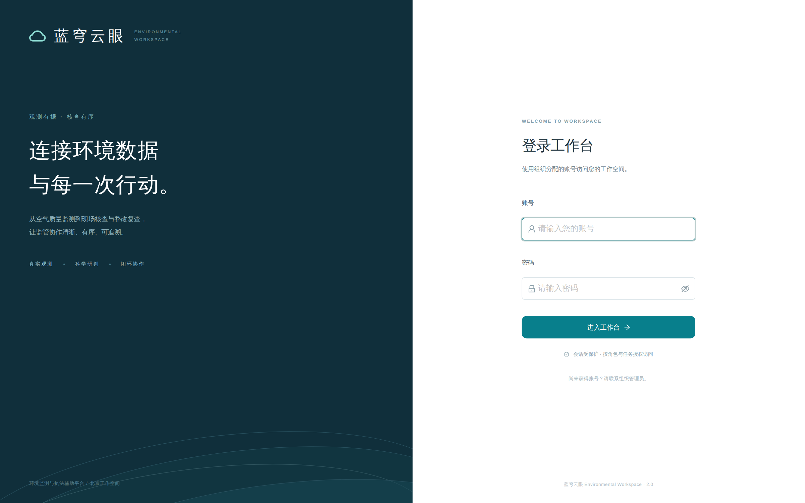

角色矩阵：

| 功能域 | 管理员 | 监管主管 | 执法人员 | 研究者 |
| --- | :-: | :-: | :-: | :-: |
| 工作台/监测/评价/预测 | ✓ | ✓ | ✓ | ✓ |
| 线索认领与登记 | ✓ | ✓ | ✓ | — |
| 任务分派/退回/审核 | ✓ | ✓ | — | — |
| 核查执行/整改录入 | — | — | ✓ | — |
| 企业档案 | ✓ | ✓ | ✓ | — |
| 模型激活/回滚 | ✓ | — | — | — |
| 标准法规维护 | ✓ | ✓ | — | — |
| 用户/数据源/审计 | ✓ | — | — | — |

说明：执法人员仅能读取本人负责或协作的核查任务；研究者无企业证据访问权；修改口令、角色或停用账号会立即吊销该用户全部服务端会话。

## 12. 工作台（按角色）

工作台为登录后首页，内容随角色变化：管理员/主管看全市态势与待办，执法人员优先看任务卡，研究者隐藏待办类卡片。

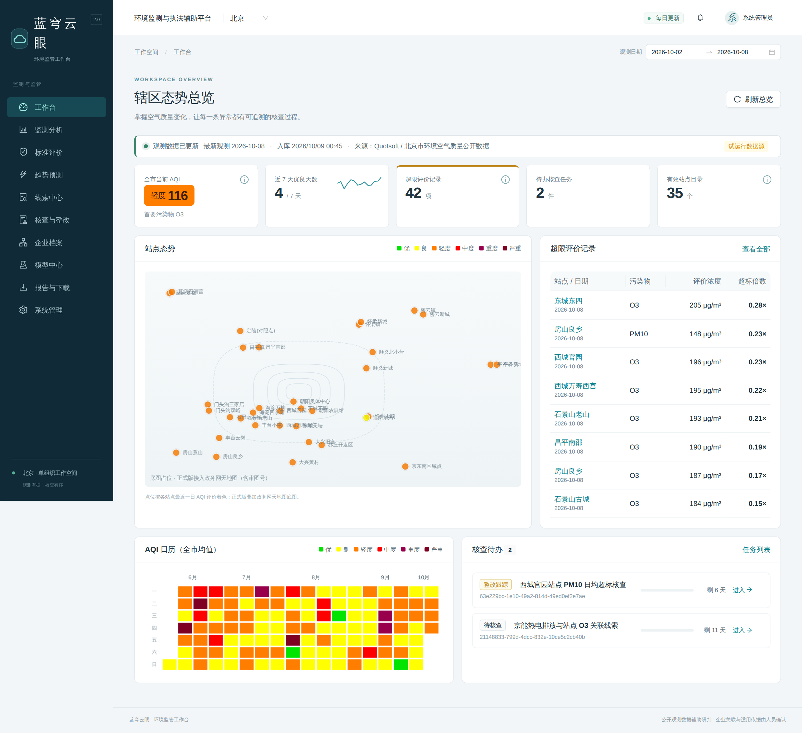

页面要素：全市当前 AQI 及首要污染物、近 7 天优良天数走势、超限评价记录数、待办核查任务数、有效站点数五个指标卡；站点态势图按最近一日 AQI 着色；AQI 日历热力矩阵（全市均值，近 5 个月）；超限评价记录表（站点/污染物/评价浓度/超标倍数）。

顶部新鲜度条明示：最新观测日期、入库时间、来源（Quotsoft/北京市环境空气质量公开数据）与"试运行数据源"标识。

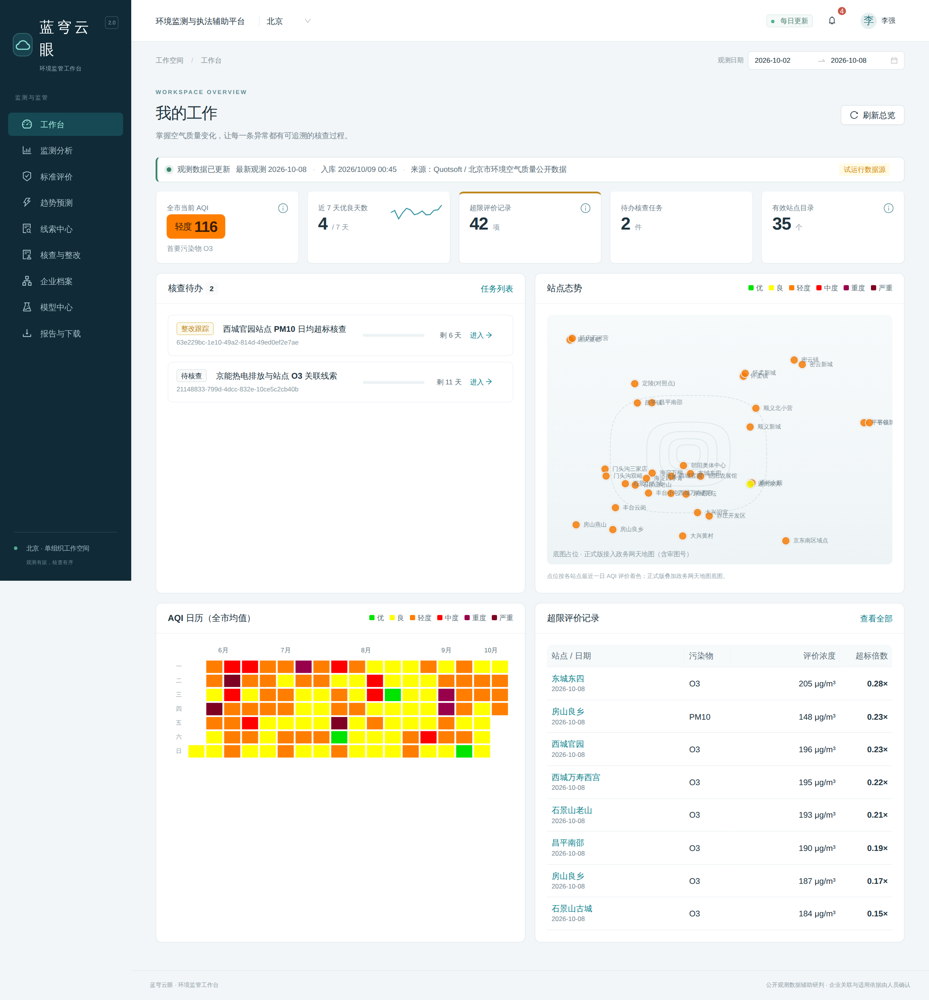

执法人员视角以"我的工作"为题，核查待办卡片置顶，标注状态（待核查/整改跟踪）与剩余天数。

## 13. 监测分析

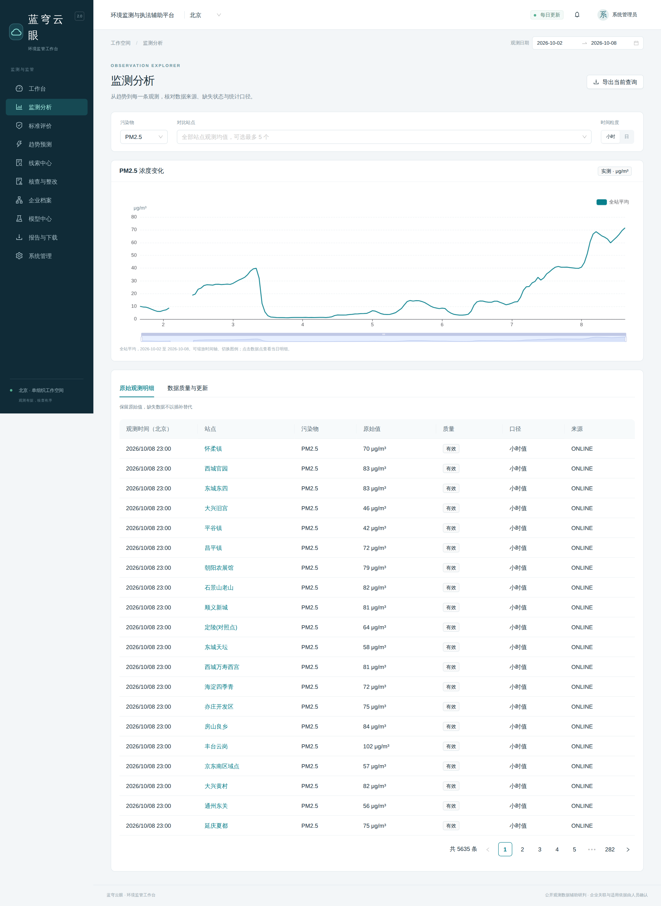

功能：站点选择（多选对比）、污染物切换（PM2.5/PM10/O3 等六项）、时序曲线（实测/插补区分绘制）、日尺度切换、数据质量视图、来源文件追溯视图。所有图表调用真实接口；无数据区间如实留白，不虚构曲线。

## 14. 站点详情

站点详情页提供：站点目录信息（名称/编码/坐标/状态）、六项污染物当前浓度、近 24 小时与近 30 日趋势、预测轨迹（如实测与预测虚线同图、含区间带）、AQI 日历热力、来源文件清单。

## 15. 标准评价与 AQI

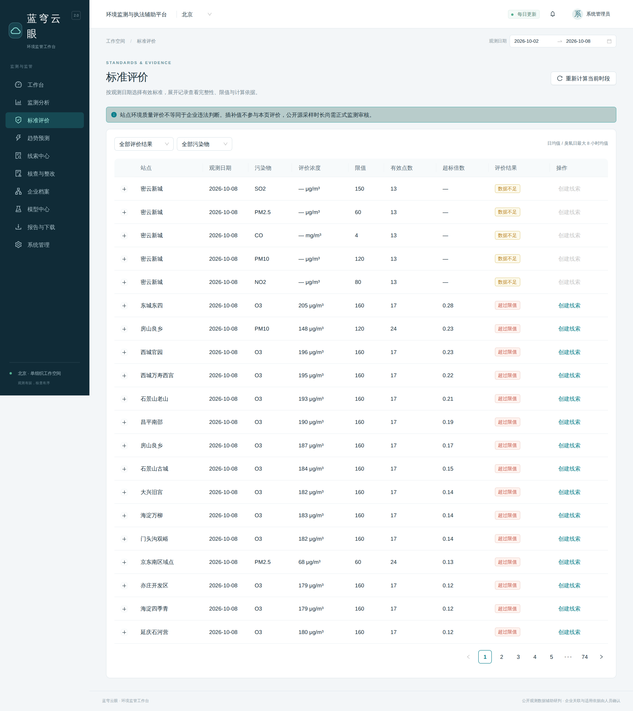

评价引擎按站点×日×污染物产出评价记录：评价浓度、适用标准（含标准快照与有效期）、超标倍数、完整性（观测小时数是否满足评价要求）。AQI 按国家标准分六级，全市 AQI 取站点聚合。页面支持按日期范围、站点、污染物、超标倍数筛选导出。

## 16. 趋势预测

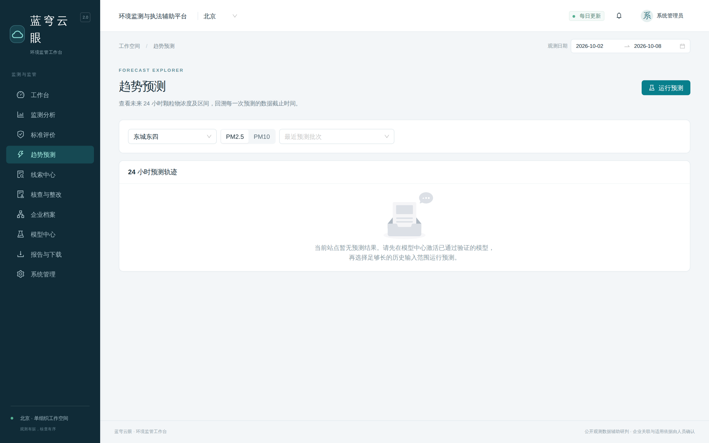

预测页面按站点+污染物查询未来 24 小时预测轨迹与置信区间，标注"预测批次"（训练任务号）与数据截止时间。未激活模型或无预测结果时明确提示"当前站点暂无预测结果"，不展示编造曲线。预测需在模型中心先激活通过验证的模型。

## 17. 线索中心

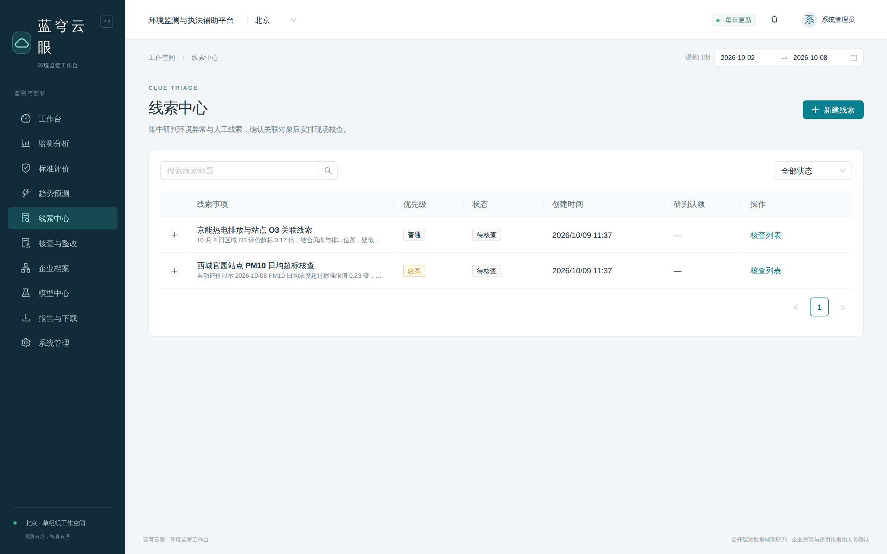

超标评价记录可生成线索；也支持人工登记（如群众举报、上级交办）。线索字段：来源类型、关联评价/站点/企业、说明、登记人、认领状态。主管分派后生成核查任务；也可退回线索并填写理由。

## 18. 核查与整改（执法闭环）

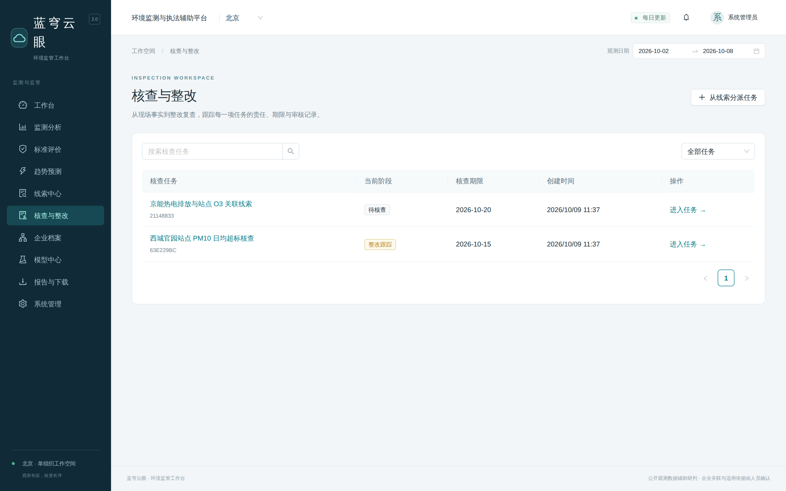

核查任务走严格状态机，页面顶部为流程时间线与期限倒计时条：

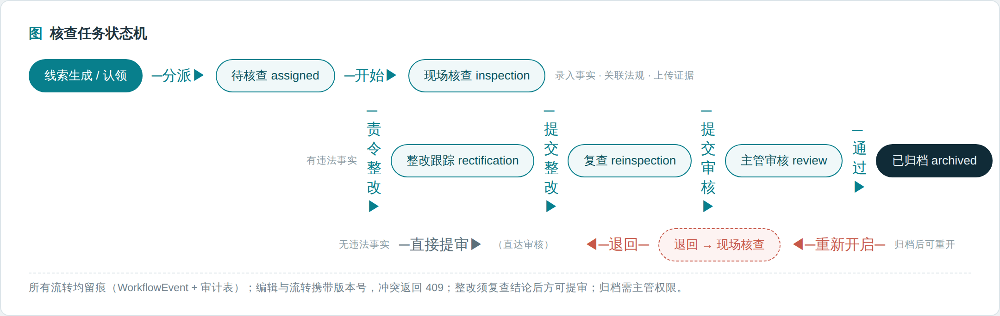

状态：已分派 → 现场核查 → 整改中 → 复查 → 审核 → 已归档；支持"审核退回至现场核查"与"归档重开至现场核查"两种逆向流转。

流转约束（服务端强制）：

- 进入整改前必须先保存核查事实；
- 法律适用条目须引用真实法规记录，并填写条款与适用理由；
- 仅现场核查阶段可新增整改事项，整改要求与期限必填；
- 提交整改前须有企业反馈；每条整改须有复核意见方可提交审核；
- 所有修改携带版本号，旧版本提交返回 409 冲突，防止并发覆盖。

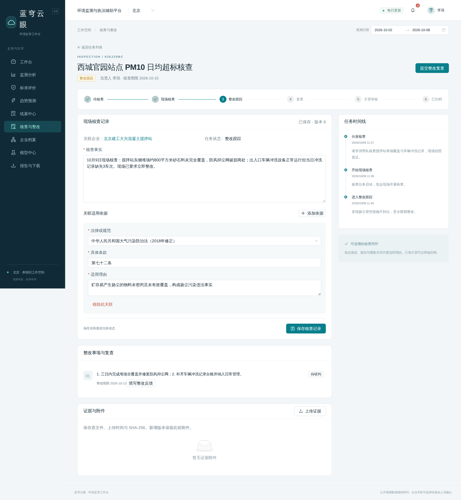

详情页按 Tab 组织：核查事实、法律适用、整改事项、附件、流转记录。附件与任务下载每次重新鉴权，私有卷不经静态目录暴露。

## 19. 企业档案

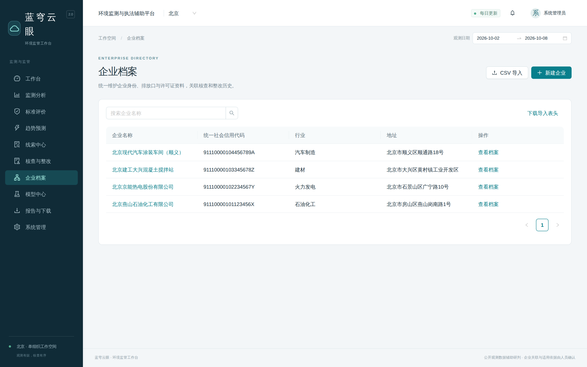

企业档案支持批量导入（CSV）与单条登记，字段含名称、统一社会信用代码、行业、地址、关联站点。详情页汇总关联线索与核查历史。

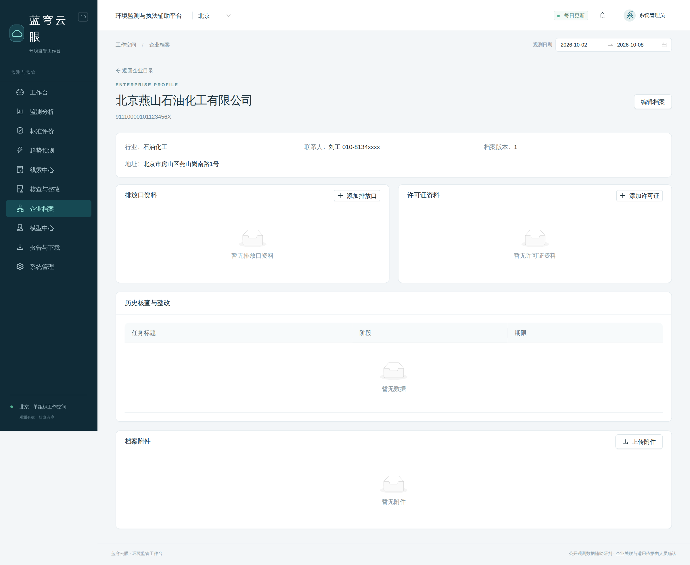

## 20. 模型中心

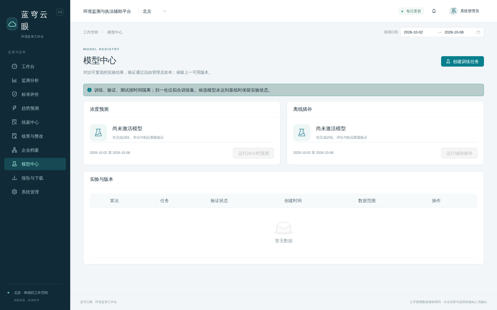

模型中心管理预测模型生命周期：登记（输入矩阵、代码哈希、随机种子、特征、环境指纹）、验证指标、激活、回滚。每次激活/回滚由管理员执行并留审计记录。训练与预测任务在独立 model-worker 进程执行，与 IO 型任务隔离。

## 21. 报告与下载

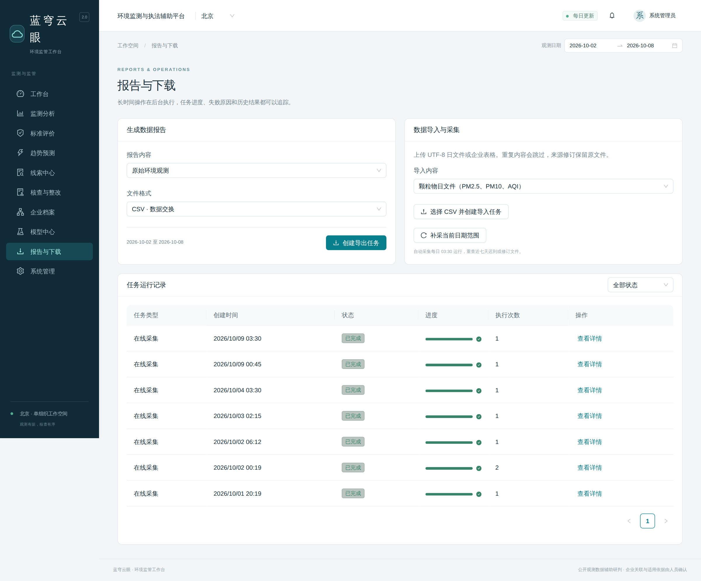

报告导出走异步任务：提交参数→后台生成→任务中心下载。导出内容绑定生成时刻的数据口径与来源文件指纹，文件落私有存储，下载按权限重新校验。

## 22. 系统管理

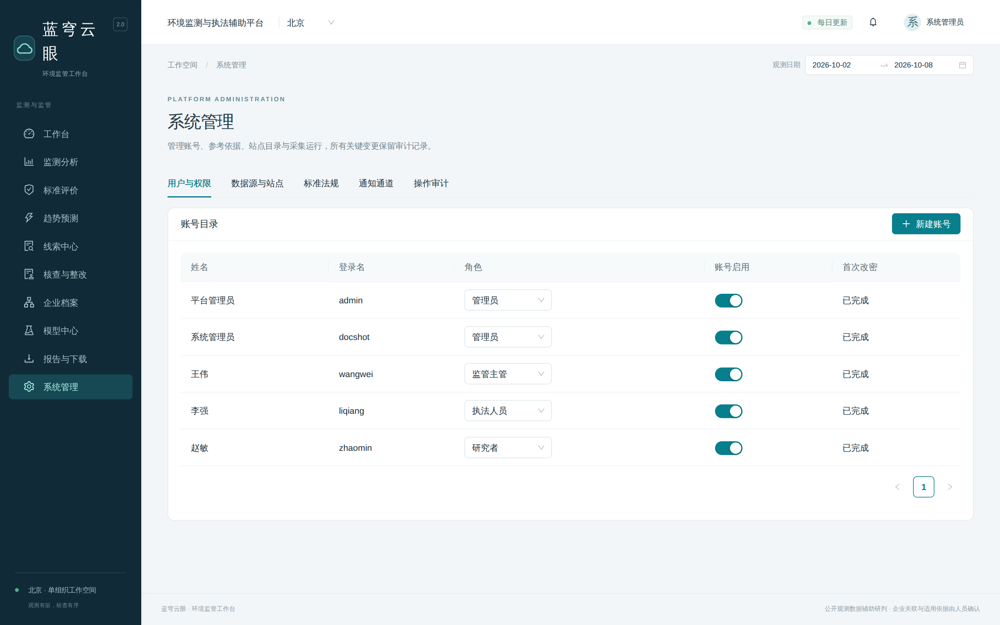

管理后台五个分区：

- **用户与权限**：账号创建、角色调整、停用/启用、强制改密；
- **数据源与站点**：来源文件清单（观测日期/文件类型/入库时间/有效修订/观测数量）、站点目录维护（坐标、别名、有效期）、数据源许可状态；
- **标准法规**：评价标准与法规的登记、有效期管理（过期不删除，保留历史快照）；
- **通知通道**：站内通知与可选外部通道（邮件等）配置与开关；
- **操作审计**：全部关键变更的审计流水（人、时、对象、动作）。

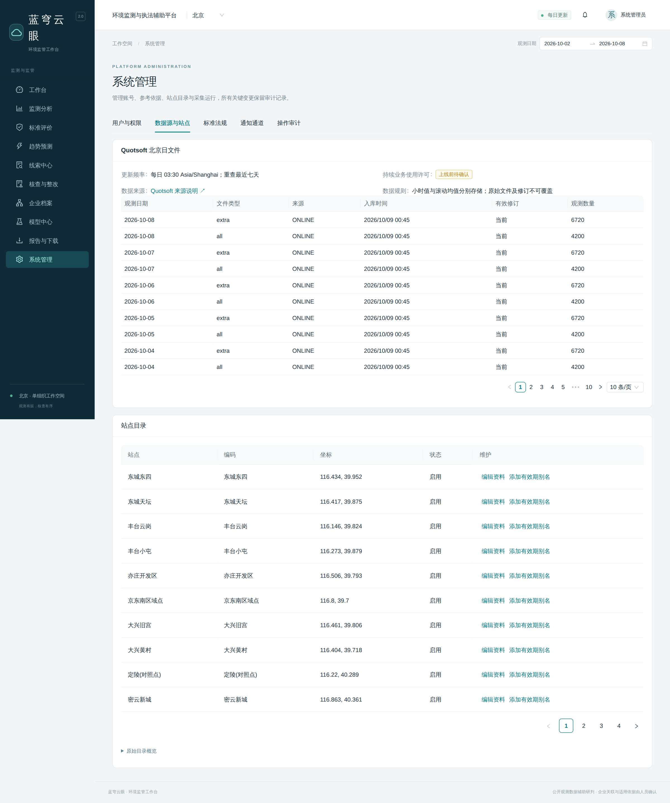

## 23. 领导驾驶舱大屏（原型示意）

大屏面向 1920×1080 展示场景设计：左侧指标与趋势、中央站点地图与回放、右侧排行与预警滚动；只读、定时刷新、多视图轮播。下图为设计原型示意，正式大屏将随政务云地图服务（天地图）接入实施。

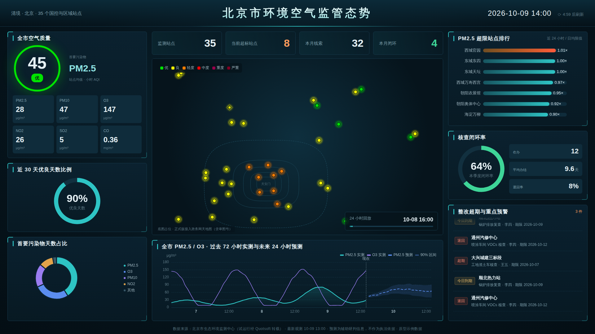

# 第五部分 数据溯源与安全

## 24. 数据源策略与适配层

采集层位于适配器边界之后：业务任务只依赖 `CollectionPort` 接口，具体数据源由 `resolve_adapter(ESP_SOURCE_PROVIDER)` 显式选择。

| source key | 适配器 | 状态 |
| --- | --- | --- |
| `quotsoft` | QuotsoftAdapter | 现役：日频宽表 CSV（date,hour,type + 站点列），UTF-8/-SIG，SHA-256 指纹，修订不覆盖 |
| `official` | OfficialSourceAdapter | 已注册、显式拒绝执行，待官方接口规范到达后实现 |

原则：正式官方模式绝不静默回退到 Quotsoft；未知 source key 直接拒绝任务。

## 25. 数据源许可门禁

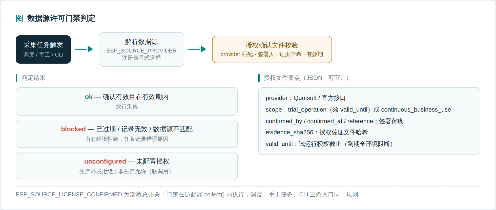

启用任一数据源须同时满足：部署开关 `ESP_SOURCE_LICENSE_CONFIRMED=true`，且确认文件 `var/platform/source-license-confirmation.json` 有效。确认文件字段：provider、record_id、confirmed_by、确认时间、scope、evidence_sha256、reference、valid_until。

规则：

- scope 取 `trial_operation`（试运行，必须带 valid_until）或 `continuous_business_use`（正式授权）；
- valid_until 到期后**所有环境**一律阻断采集；
- 文件 provider 须与当前数据源一致，防止 Quotsoft 授权冒名官方接口；
- 确认时间不晚于当前时间，杜绝事后补造；
- 门禁统一作用于 HTTP 任务提交、CLI、调度器、Worker 执行与 `/admin/sources` 展示（返回 ok/unconfigured/blocked 三态）。

## 26. 数据可信度标识体系

| 标识 | 含义 | 页面表现 |
| --- | --- | --- |
| 实测 | 原始观测，绑来源文件指纹 | 实线/正常点 |
| 插补 | 缺失段补齐，写入 DerivedValue | 紫色菱形标记 |
| 预测 | 模型产出，绑预测批次 | 虚线+置信区间带 |
| 缺失 | 该时段无数据 | 灰底纹区域如实留白 |
| 已修订 | 来源文件出新修订，旧版保留 | 文件清单可见修订链 |

## 27. 安全机制

- 会话 Cookie HttpOnly，CSRF 令牌与 Origin 双校验；
- 口令 Argon2 散列，失败计数锁定，改密/改角色/停用即吊销全部会话；
- 越权拒绝与登录失败独立提交审计，不被业务回滚吞掉；
- 全局页面水印（用户名+工号+日期），震慑截图外发；
- 附件/导出文件私有存储，每次访问重新鉴权；
- 错误响应统一 `code/message/details/request_id`，不泄露 SQL、路径与密钥；
- 日志经敏感信息过滤器，杜绝口令与令牌落盘。

# 第六部分 接口与非功能

## 28. API v2 契约摘要

- 分页：`page_number`/`page_size`，返回 `items,total,page,page_size,request_id`，稳定主键排序；
- 异步任务：`POST /jobs`、`POST /imports` 返回 202+`job_id`；`GET /jobs/{id}` 查状态/进度/结果；
- 时间口径：北京时间自然日入参，观测瞬时值存 UTC；
- 幂等：任务提交按目标指纹+PG 事务锁去重；通知按幂等键；
- 文档：运行时 `/api/v2/docs`（OpenAPI），前端类型由契约生成。

## 29. 非功能指标与验证

| 项 | 现状 |
| --- | --- |
| 后端单测 | 66 通过 / 6 跳过（容器内 pytest） |
| 类型检查 | mypy 严格模式 86 文件零告警；前端 tsc 通过 |
| 前端测试 | vitest 通过；生产构建通过（存在 >500kB chunk 告警，列入优化项） |
| 数据规模 | 798 万条观测、35 站点（试运行库实测） |
| 部署验证 | 七容器 compose 拓扑全部健康，`/health/ready` 就绪探针 |

# 附录

## 附录 A 截图索引

| 编号 | 图 | 说明 |
| --- | --- | --- |
| m01 | 登录页 | 蓝穹云眼品牌登录 |
| m02 | 工作台-管理员 | 指标卡+站点地图+AQI 日历 |
| m03 | 监测分析 | 站点对比与污染物切换 |
| m04 | 站点详情 | 趋势/预测/日历/来源文件 |
| m05 | 标准评价 | 超标倍数与标准快照 |
| m06 | 趋势预测 | 预测轨迹与批次溯源 |
| m07 | 线索中心 | 线索生成与认领 |
| m08/m16/m17 | 核查列表/详情/执法视角 | 执法闭环 |
| m09/m10 | 企业列表/详情 | 企业档案 |
| m11 | 模型中心 | 模型登记/激活/回滚 |
| m12 | 报告与下载 | 异步导出 |
| m13/m14 | 系统管理/数据源 | 用户/站点/许可/审计 |
| m15/m18 | 工作台-执法/研究 | 角色差异化视图 |
| m19 | 监测分析-研究者 | 研究视角 |
| proto-screen | 大屏 | 原型示意 |

## 附录 B 关键字段字典

| 字段 | 所属 | 说明 |
| --- | --- | --- |
| source_file.sha256 | 采集 | 原始文件指纹，修订链锚点 |
| evaluation.standard_snapshot | 评价 | 评价时生效标准快照 |
| inspection.version | 核查 | 乐观并发版本号，冲突返回 409 |
| job.kind | 任务 | collect/import/evaluate/train/predict/impute/export |
| license.scope | 许可 | trial_operation / continuous_business_use |
| station.latitude/longitude | 站点目录 | 参考数据，部署种子维护，不由前端虚构 |

## 附录 C 版本与变更记录

| 版本 | 内容 |
| --- | --- |
| v2.0 试运行版 | v2 模块化重构；蓝穹云眼设计系统落地；采集适配器与许可门禁；35 站点坐标建库 |
